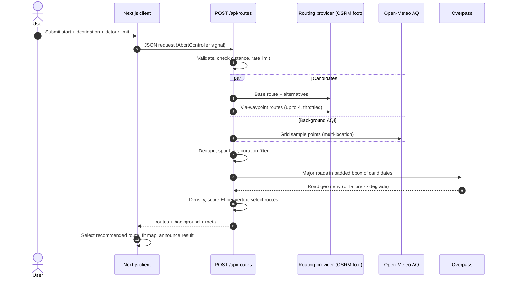
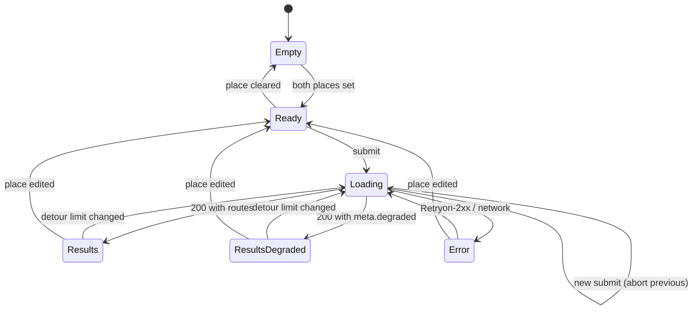
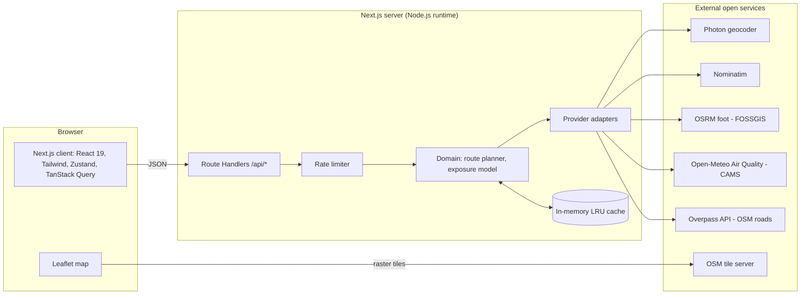
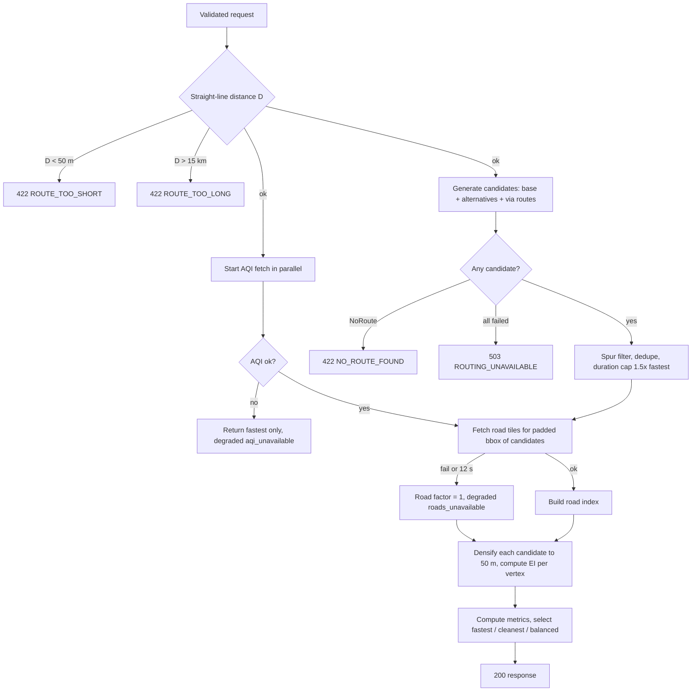

# BreatheWay — Product Requirements Document (PRD)

| Field | Value |
|---|---|
| **Product** | BreatheWay — Eco-Route Air Quality Navigation Web App |
| **Document version** | 1.0 (implementation-ready) |
| **Date** | 2026-10-14 |
| **Primary reader** | AI coding agent in Google Antigravity (source of truth), plus the hackathon team |
| **Hackathon theme** | UN SDG 3 — Good Health and Well-being (Target 3.9: reduce illness from air pollution) |
| **Mandated stack** | Next.js, OpenStreetMap / Leaflet, Node.js |
| **Companion Documents** | [architecture.md](file:///g:/work%20space/BioSolve-/architecture.md), [build-rule.md](file:///g:/work%20space/BioSolve-/build-rule.md), [implementation-plan.md](file:///g:/work%20space/BioSolve-/implementation-plan.md), [build-progress.md](file:///g:/work%20space/BioSolve-/build-progress.md) |

**Conventions.** Requirement IDs look like `FR-02.3` (functional, feature 02, item 3) and `NFR-07`. Priorities: **P0** = MVP, must ship; **P1** = should ship if time allows; **P2** = future. "MUST/SHOULD/MAY" follow RFC 2119. All coordinates are WGS84. GeoJSON order is `[lng, lat]`; app-level objects use `{ lat, lng }`.

---

## Table of Contents

1. [Executive Summary](#1-executive-summary)
2. [Product Vision and Problem Statement](#2-product-vision-and-problem-statement)
3. [Goals, Success Metrics, and Scope](#3-goals-success-metrics-and-scope)
4. [Target Users and Personas](#4-target-users-and-personas)
5. [Functional Requirements and Feature Specifications](#5-functional-requirements-and-feature-specifications)
6. [User Journeys and Workflows](#6-user-journeys-and-workflows)
7. [Information Architecture and Navigation](#7-information-architecture-and-navigation)
8. [UI/UX Design System](#8-uiux-design-system)
9. [Screen-by-Screen Specifications](#9-screen-by-screen-specifications)
10. [Technology Stack and Technical Rationale](#10-technology-stack-and-technical-rationale)
11. [System Architecture and Project Structure](#11-system-architecture-and-project-structure)
12. [Routing Specification](#12-routing-specification)
13. [API Contracts](#13-api-contracts)
14. [Database Schema and Data Relationships](#14-database-schema-and-data-relationships)
15. [Authentication, Security, and Privacy](#15-authentication-security-and-privacy)
16. [Third-Party Integrations](#16-third-party-integrations)
17. [Business Logic and State Management](#17-business-logic-and-state-management)
18. [Non-Functional Requirements](#18-non-functional-requirements)
19. [Testing and Quality Assurance](#19-testing-and-quality-assurance)
20. [Implementation Roadmap](#20-implementation-roadmap)
21. [Antigravity Execution Guidelines](#21-antigravity-execution-guidelines)
22. [Deployment and Production Readiness](#22-deployment-and-production-readiness)
23. [Risks, Dependencies, and Assumptions](#23-risks-dependencies-and-assumptions)
24. [Acceptance Criteria and Definition of Done](#24-acceptance-criteria-and-definition-of-done)
25. [Appendices, Glossary, and Supporting Diagrams](#25-appendices-glossary-and-supporting-diagrams)

---

## 1. Executive Summary

**BreatheWay** is a map-based web app where a user enters a start and an end point and receives **walking routes ranked by estimated air-pollution exposure**, not only by speed. It shows the fastest route next to a cleaner alternative and quantifies the trade-off ("**18% lower estimated exposure, +3 min**").

### 1.1 How it works (one paragraph)

The Node.js backend (Next.js Route Handlers) asks a walking router for several candidate routes, fetches **real current AQI** from Open-Meteo (CAMS data), fetches **real major-road geometry** from OpenStreetMap (Overpass), and scores every route with a documented **Exposure Index**: background AQI multiplied by a traffic-proximity factor that rises near busy roads. The cleanest route within a user-chosen detour limit is recommended. The frontend (Next.js + Leaflet) draws each route with segments colored by estimated exposure.

### 1.2 Why a hybrid model (critical design insight)

Open-source AQI data is **coarse**. Open-Meteo's air-quality data is derived from the CAMS European forecast (~11 km grid) and the CAMS global forecast (~45 km grid). Within a campus or city walk, background AQI is therefore almost constant, and AQI alone **cannot** distinguish two nearby streets. Street-level differences come mainly from proximity to traffic. BreatheWay therefore combines (a) real regional AQI with (b) a road-proximity factor derived from real OSM road data. This is a modelled **relative exposure estimate**, not a measured street-level concentration, and the product says so everywhere it matters (UI copy, About page, API metadata).

### 1.3 Decision log

| ID | Decision | Rationale |
|---|---|---|
| D-01 | **Walking only** in MVP | Matches the problem statement ("students walking"); keeps routing and exposure logic tractable. |
| D-02 | **One Next.js app (App Router)**; backend = Route Handlers on the **Node.js runtime**; domain logic in `src/server/` with no Next.js imports | Satisfies "Next.js + Node.js" with one deployable. Domain code stays extractable to Express if organizers require a separate server. |
| D-03 | **No user accounts and no database** in MVP | No feature needs identity. Avoids PII, auth surface, and setup time. Client preferences live in `localStorage`. |
| D-04 | **Hybrid Exposure Index** (background AQI × road-proximity factor) | See §1.2. Gives meaningful route differences and stays explainable to judges. |
| D-05 | **Keyless public providers by default** (Open-Meteo, Photon, FOSSGIS OSRM, Overpass, Nominatim fallback) | The app works with zero credentials; no secret handling required for MVP. |
| D-06 | **Candidate routes = provider alternatives + perpendicular via-waypoint routes**, then dedupe and filter | Router alternatives are often 1-2 near-identical routes for short walks; via-routes create real diversity. |
| D-07 | **US AQI (0–500)** as the displayed scale | Open-Meteo provides US and European AQI only. India's national AQI is not provided (documented limitation). |
| D-08 | **Photon** for typeahead; **Nominatim** only for explicit submit and as fallback | Nominatim's public policy forbids client-side autocomplete. Photon allows fair use. |
| D-09 | **In-memory LRU cache** behind a `CacheStore` interface | Zero infrastructure; interface allows Redis later. Serverless caches are per-instance (documented). |
| D-10 | **Light theme only** in MVP | OSM raster tiles are light; dark mode adds a state matrix without product value. |
| D-11 | **Mock providers exist for tests/dev only** and force a visible "Simulated data" banner | Prevents simulated results from being mistaken for real ones. |
| D-12 | **Neutral global default map view**, configurable via env | The demo city/campus is a deployment choice. App never assumes a location. |

---

## 2. Product Vision and Problem Statement

### 2.1 Vision

Make invisible air pollution visible and actionable at the moment people choose how to walk, so cleaner routes become a habit and respiratory exposure falls.

### 2.2 Problem statement

Students and city walkers pick routes by distance or time. Pollution exposure is invisible, and mainstream navigation does not factor it in. People routinely walk along high-traffic roads when a parallel street, park path, or lightly trafficked lane a short distance away would expose them to less pollution. Repeated exposure to traffic-related pollution is associated with respiratory and cardiovascular harm, and people with asthma or other respiratory conditions are especially vulnerable.

### 2.3 Proposed solution

A web app that: (1) takes start/end points, (2) generates multiple real walking routes, (3) estimates exposure along each from real AQI and real road data, (4) recommends the cleanest route within a tolerable detour, and (5) explains the trade-off in plain language with a transparent methodology.

### 2.4 Value proposition and differentiators

| Differentiator | Detail |
|---|---|
| Exposure, not just time | Every route shows distance, time **and** estimated exposure; recommendation honors a detour limit. |
| Street-level insight from open data | Hybrid model beats raw station/grid AQI for route comparison. |
| Honest and transparent | In-app methodology page; degraded modes announced; no fake precision. |
| Zero-friction | No sign-up, no API keys, works on mobile browsers. |
| Open stack | OSM data, Leaflet, public CAMS data. Fully reproducible. |

### 2.5 What the product does not claim

It does not measure personal exposure, give medical advice, or provide street-level pollutant concentrations. Its Exposure Index is a **relative, modelled** indicator expressed on the AQI scale for intuition.

---

## 3. Goals, Success Metrics, and Scope

### 3.1 Objectives

| ID | Objective |
|---|---|
| O1 | A user can obtain a fastest-vs-cleanest walking comparison for any two points within the supported distance range, with no setup. |
| O2 | Results use real AQI data and real OSM-derived road/route data, never hard-coded values (except in clearly labeled test mode). |
| O3 | The trade-off (exposure change vs extra time) is understandable in under 10 seconds of looking at the result. |
| O4 | The app degrades gracefully when any upstream service fails and always tells the user what happened. |
| O5 | The hackathon demo runs reliably end-to-end and the methodology is defensible to judges. |

### 3.2 Success metrics

Measurement conditions: production build, healthy public upstreams, cold = empty cache, warm = repeated identical request. Targets are acceptance thresholds for the hackathon, not guarantees.

| ID | Metric | Target | How measured |
|---|---|---|---|
| M1 | `POST /api/routes` latency, cold | median ≤ 8 s, p95 ≤ 15 s | `Server-Timing` header; `scripts/benchmark.ts` over 20 origin/destination pairs |
| M2 | `POST /api/routes` latency, warm | median ≤ 1.5 s | Same script, second run |
| M3 | Route-computation success rate (valid inputs, healthy upstreams) | ≥ 95% of benchmark pairs return ≥ 1 route | Benchmark script |
| M4 | Pairs where a cleaner alternative is offered (reduction ≥ 3%) | Reported, not targeted (depends on geography). Show the distribution in the demo. | Benchmark script output (median, p25, p75 of reduction %, and extra minutes) |
| M5 | Lighthouse mobile (production build, median of 3) | Accessibility ≥ 95; LCP ≤ 2.5 s on "Slow 4G" emulation for `/` | Lighthouse |
| M6 | Automated accessibility | 0 serious/critical axe violations on `/` and `/about` | `@axe-core/playwright` |
| M7 | Test health | Unit/integration pass; ≥ 80% line coverage on `src/server/domain` and `src/lib` | Vitest coverage |

### 3.3 MVP scope (P0)

F-01 Place search and selection · F-02 Route computation and exposure scoring · F-03 Map visualization · F-04 Route comparison panel · F-05 Detour limit · F-06 Air quality context · F-07 Shareable deep links · F-08 Degraded modes and status messaging · F-09 About / methodology page · F-10 Local recents and preferences · Health endpoint.

### 3.4 Future enhancements (P1/P2)

| Priority | Item |
|---|---|
| P1 | OpenAQ station overlay and station-based calibration of background AQI (requires free OpenAQ API key). |
| P1 | OpenRouteService adapter (key required) behind the existing `RoutingProvider` interface. |
| P1 | "Leave now vs later" using Open-Meteo hourly forecast. |
| P1 | Green-space bonus (OSM parks/forest polygons) in the exposure model. |
| P2 | Accounts and saved routes; dark mode; i18n; units toggle (miles); cycling profile; native app; self-hosted router/Overpass; PWA offline shell. |

### 3.5 Explicitly excluded (MVP)

User accounts, a database, push notifications, turn-by-turn navigation, driving/transit/cycling, medical advice or personalized health thresholds, ads, analytics/tracking cookies, crowd-sourced pollution reports, any claim of measured street-level concentrations.

---

## 4. Target Users and Personas

| Persona | Profile | Needs | Success looks like |
|---|---|---|---|
| **Priya, 19, first-year student with asthma** | Walks 20 min between hostel and campus along a busy road. Phone-first. | Lower exposure without a large detour; plain-language explanation. | Picks the cleaner route and understands "+3 min, 18% less exposure". |
| **Daniel, 22, sustainability-club member** | Walks daily, shares findings with friends. | Share a link to a comparison; credible methodology. | Sends a deep link and cites the About page. |
| **Marcus, hackathon judge** | Has 3 minutes per team. | See a working demo with real data; judge rigor and SDG fit. | Sees live results, a visible comparison, honest limits, clean UX. |

### 4.1 Primary use cases

| ID | Use case |
|---|---|
| UC-1 | Search two places by name and see fastest vs cleanest walking routes. |
| UC-2 | Use "my location" as the start. |
| UC-3 | Pick a point directly on the map. |
| UC-4 | Choose how much extra time is acceptable (detour limit). |
| UC-5 | Share or revisit a comparison via URL. |
| UC-6 | Learn how the Exposure Index is computed and what its limits are. |
| UC-7 | Understand what happened when a data source is unavailable. |

---

## 5. Functional Requirements and Feature Specifications

Common to all features: **no authentication or roles** (all functionality is public); **no database** (see §14); errors use the envelope in §13.1; copy strings are in §9.6.

### F-01 Place Search and Selection (P0)

- **Purpose:** Let users define start and end points by name, geolocation, or map click.
- **User story:** As a walker, I want to type a place name or tap the map so I can set my start and destination quickly.
- **Functional requirements**
  - FR-01.1 Two inputs, "Start" and "Destination", each a WAI-ARIA 1.2 combobox with a suggestion listbox.
  - FR-01.2 Typeahead MUST start at ≥ 3 characters, debounced 350 ms, abort stale requests, show at most 6 suggestions.
  - FR-01.3 Suggestions come from `GET /api/geocode`; bias toward the current map center when available.
  - FR-01.4 Selecting a suggestion sets the place (label, lat, lng) and closes the list.
  - FR-01.5 Pressing Enter with free text and no highlighted suggestion triggers an explicit search (`GET /api/geocode?q=…&explicit=1`, Nominatim-capable path) and selects the first result; zero results shows an inline error.
  - FR-01.6 Start input has a "Use my location" button using `navigator.geolocation.getCurrentPosition` (enableHighAccuracy: false, timeout 10 s, maximumAge 60 s), only on explicit click. On success, reverse-geocode for a label (fallback label "Current location").
  - FR-01.7 Each input has a "Pick on map" button that activates pick mode (§9.1). The next map click sets that point and reverse-geocodes it (`GET /api/geocode/reverse`); if reverse geocoding fails the label is "Dropped pin (lat, lng)" with 4-decimal precision.
  - FR-01.8 A "Swap" button exchanges start and destination (and their labels).
  - FR-01.9 Empty focused inputs show up to 5 recent places from `localStorage` (F-10).
  - FR-01.10 A clear (×) button empties an input and its marker.
- **Inputs / validation:** `q` string 3–120 chars after trim; control characters stripped; lat ∈ [−90, 90], lng ∈ [−180, 180].
- **States:** *idle* (placeholder "Search a place or address"); *loading* (spinner in input, `aria-busy`); *suggestions*; *empty* ("No places found. Try a nearby landmark or tap the map."); *error* ("Place search is unavailable right now. You can still tap the map to set a point."); *geolocation denied* ("Location permission was denied. Search for a place or tap the map instead."); *geolocation unavailable/timeout* similar copy.
- **API:** `GET /api/geocode`, `GET /api/geocode/reverse`. **DB:** none (client `localStorage`).
- **Acceptance criteria**
  - AC-01.1 *Given* the user types "mu" *then* no request is sent. *Given* 3+ characters *then* exactly one request is sent after 350 ms of inactivity.
  - AC-01.2 *Given* suggestions are open *when* ArrowDown/ArrowUp/Enter/Escape are pressed *then* options are highlighted, selected, or the list closes, and `aria-activedescendant` tracks the highlighted option.
  - AC-01.3 *Given* geolocation permission is denied *then* the denial message is displayed and no coordinates are set.
  - AC-01.4 *Given* both places are set *when* Swap is activated *then* inputs and markers exchange positions.
- **Dependencies:** F-03 (markers, pick mode), F-10.

### F-02 Route Computation and Exposure Scoring (P0, core)

- **Purpose:** Produce up to three labeled walking routes (Fastest, Cleanest, Balanced) with exposure metrics.
- **User story:** As a walker, I want to see the route with the least pollution exposure that doesn't take unreasonably longer.
- **Functional requirements**
  - FR-02.1 Submit is enabled only when both places are set and differ by ≥ 50 m straight-line.
  - FR-02.2 Straight-line distance MUST be ≤ 15 km; otherwise the API returns `ROUTE_TOO_LONG` and the UI shows its message.
  - FR-02.3 The server generates candidates, scores them, and selects routes per §17.
  - FR-02.4 Each route includes: distance, duration, average and max Exposure Index (EI), EI category, `nearTrafficPct`, comparison versus fastest, GeoJSON geometry, per-vertex EI array.
  - FR-02.5 If the cleanest route is not meaningfully cleaner (< 3% reduction) the response contains the fastest route tagged `["fastest","cleanest"]` and the UI states "The fastest route is already among the cleanest."
  - FR-02.6 A new submit aborts any in-flight request; duplicate submits with identical inputs while pending are ignored.
  - FR-02.7 Missing AQI data or missing road data yields a **degraded** (still HTTP 200) response per F-08.
- **States:** *idle*; *loading* (skeleton cards, "Analyzing routes…", button shows spinner and is disabled); *success*; *success-degraded*; *error* (mapped from error code, §13.1) with a Retry button.
- **API:** `POST /api/routes`. **DB:** none.
- **Acceptance criteria**
  - AC-02.1 *Given* valid start/end 2 km apart and healthy upstreams *then* ≥ 1 route returns, exactly one has tag `fastest`, and `recommendedRouteId` references a returned route.
  - AC-02.2 *Given* identical inputs repeated within the cache TTL *then* `meta.cache.routing` is `hit` and total compute time is lower.
  - AC-02.3 *Given* start/end 20 km apart *then* HTTP 422 with `error.code = "ROUTE_TOO_LONG"`.
  - AC-02.4 *Given* Open-Meteo fails *then* HTTP 200, `meta.degraded` contains `"aqi_unavailable"`, and only the fastest route is returned.
  - AC-02.5 For every returned route, `exposure.length === geometry.coordinates.length`.
- **Dependencies:** F-01, F-05, providers (§16).

### F-03 Map Visualization (P0)

- **Purpose:** Show places and routes on an OSM-based Leaflet map.
- **Functional requirements**
  - FR-03.1 Leaflet map (react-leaflet) with OSM raster tiles, attribution visible at all times, zoom controls, keyboard pan/zoom.
  - FR-03.2 Start marker "A" (teal) and destination marker "B" (slate) as `L.divIcon` markers (no default marker images).
  - FR-03.3 Selected route: white casing polyline plus colored runs (consecutive edges of the same EI category merged into one polyline). Unselected routes: single slate polyline, 70% opacity, clickable to select.
  - FR-03.4 On new results, fit bounds to all returned routes with padding (§9.1).
  - FR-03.5 AQI legend (six categories, text + color) on the map, bottom-left (desktop) / inside the sheet (mobile).
  - FR-03.6 Pick mode: crosshair cursor, banner "Click the map to set the start point", Esc cancels.
  - FR-03.7 Map is loaded client-side only (`dynamic(..., { ssr: false })`) with a skeleton while loading.
  - FR-03.8 Initial view is `NEXT_PUBLIC_DEFAULT_MAP_CENTER` / `NEXT_PUBLIC_DEFAULT_MAP_ZOOM`.
- **States:** *loading* (skeleton), *tile error* (Leaflet shows grey tiles; app shows a non-blocking notice after ≥ 5 consecutive `tileerror` events: "Map tiles are failing to load. Routes are still listed below."), *empty* (no routes), *routes shown*.
- **Acceptance criteria**
  - AC-03.1 Attribution "© OpenStreetMap contributors" is visible on `/` at all breakpoints.
  - AC-03.2 *Given* results *then* the map viewport contains every vertex of every returned route.
  - AC-03.3 *Given* an unselected route is clicked *then* it becomes selected and its card is highlighted and scrolled into view.
  - AC-03.4 No hydration errors or `window is not defined` errors occur on first load.

### F-04 Route Comparison Panel (P0)

- **Purpose:** Present each route's metrics and the trade-off in plain language.
- **Functional requirements**
  - FR-04.1 One `RouteCard` per route, ordered: recommended route first, then the others by duration.
  - FR-04.2 Card content: tag chips (Fastest / Cleanest / Balanced; icons Zap / Leaf / Scale), duration (min), distance (km, or m if < 1 km), average EI with category label and color swatch, `vsFastest` line ("**18% lower exposure · +3 min**" or "Baseline"), and an expandable "Details" section (max EI, % of route near major roads, EI-category mix as a text sentence).
  - FR-04.3 Exactly one card is selected at a time (default = recommended route) via a radio-group pattern; selection syncs with the map.
  - FR-04.4 An `aria-live="polite"` region announces results (§9.6).
  - FR-04.5 A "Not medical advice" note and a link to `/about#methodology` appear below the cards.
- **Acceptance criteria**
  - AC-04.1 Card text never relies on color alone; each EI shows category text.
  - AC-04.2 Keyboard: arrow keys move selection within the route group; Space/Enter selects.

### F-05 Detour Limit (P0)

- **Purpose:** Let users control how much extra time they accept for a cleaner route.
- **Functional requirements**
  - FR-05.1 Radio group with presets: **Strict** (≤ +15% time), **Standard** (≤ +30%, default), **Flexible** (≤ +50%). Hard cap +20 min and minimum allowance +2 min regardless of preset (§17.3).
  - FR-05.2 Changing the preset after a result exists re-runs the computation (same inputs) automatically.
  - FR-05.3 The preset persists in `localStorage` (F-10) and in the URL (`dl`).
- **Acceptance criteria:** AC-05.1 *Given* Flexible vs Strict on the same pair *then* the returned cleanest route under Flexible has duration ≤ fastest × 1.5 (or the +20 min cap) and under Strict ≤ fastest × 1.15 (or the +2 min minimum allowance).

### F-06 Air Quality Context (P0)

- **Purpose:** Show current regional AQI so users trust and understand the result.
- **Functional requirements**
  - FR-06.1 `AirQualityChip` shows "Air quality near start: **87 · Moderate**" with color swatch and "Updated 14:30" (local time, from `observedAt`).
  - FR-06.2 After a route result, the chip uses `background` from the route response. Before a result, if the start is set, it calls `GET /api/aqi`.
  - FR-06.3 Expandable details: PM2.5, PM10, NO₂ values with units (µg/m³) when present.
  - FR-06.4 Data attribution line: "Air quality: CAMS via Open-Meteo".
  - FR-06.5 When `usAqi ≤ 50`, show an info banner: "Air quality is currently good in this area, so route choice matters less." (routes still shown).
  - FR-06.6 When `usAqi ≥ 151`, show an info banner: "Air quality is poor right now. Consider limiting time outdoors where you can." (generic, not medical advice).
- **States:** loading skeleton, success, unavailable ("Air quality data unavailable right now.").
- **Acceptance criteria:** AC-06.1 Category text and color match the US AQI breakpoints in §8.2 for boundary values 50/51, 100/101, 150/151, 200/201, 300/301.

### F-07 Shareable Deep Links and History (P0)

- **Functional requirements**
  - FR-07.1 The planner state is encoded in query params on `/` (§12.2): `o`, `d`, `on`, `dn`, `dl`.
  - FR-07.2 On load with valid `o` and `d`, the app populates inputs and **automatically runs** the computation.
  - FR-07.3 Each successful submit **pushes** a history entry; changing only the detour limit uses `replace`. Back/Forward restore the corresponding state and re-run.
  - FR-07.4 Invalid or out-of-range params are ignored and a non-blocking info toast says "Some link parameters were invalid and were ignored."
  - FR-07.5 A "Copy link" button copies the current URL (`navigator.clipboard`, fallback: select-and-copy input) and announces "Link copied".
- **Acceptance criteria:** AC-07.1 Opening a copied link in a new tab reproduces the same routes (subject to current AQI).

### F-08 Degraded Modes and Status Messaging (P0)

| Condition | Behavior | `meta.degraded` code | Banner (warning style) |
|---|---|---|---|
| Open-Meteo unavailable/timeout/no value | Return fastest route only, no EI values | `aqi_unavailable` | "Air quality data is unavailable, so we're showing the fastest route only." |
| Overpass unavailable (both mirrors) or > 12 s | EI = background AQI only (road factor = 1) | `roads_unavailable` | "Road data is unavailable, so routes are compared using regional air quality only. Differences may be small." |
| All via-candidate requests fail, base route ok | Single route | `alternatives_unavailable` | "Only one walking route could be found." |
| Mock providers active | All data synthetic | `mocked` | "Simulated data. Not real air quality. For development and testing only." |
| Tile errors (client) | Non-blocking notice | n/a (client) | See F-03 |

- FR-08.1 Banners are rendered by `StatusBanner` with `role="status"`; error banners use `role="alert"`.
- FR-08.2 When both AQI and routing fail, the response is an error (§13.1), never an empty 200.

### F-09 About / Methodology Page (P0)

- **Functional requirements**
  - FR-09.1 Static page `/about` with sections: *How BreatheWay works*, *Methodology* (#methodology; Exposure Index definition, parameters, limitations), *Data sources and licenses* (CAMS/Open-Meteo, OpenStreetMap contributors/ODbL, Photon, FOSSGIS OSRM), *Limitations*, *Privacy* (#privacy), *SDG 3 alignment*.
  - FR-09.2 Parameters displayed on the page are imported from `src/lib/exposure-config.ts` (the same module the server scoring uses) so the page cannot drift from the code.
  - FR-09.3 States that the Exposure Index is a relative, modelled estimate and not medical advice.
- **Acceptance criteria:** AC-09.1 Page lists every data source from §16 with attribution text; AC-09.2 passes axe with 0 serious/critical violations.

### F-10 Local Recents and Preferences (P0)

- **Functional requirements**
  - FR-10.1 `localStorage` key `bw:v1:recents` stores ≤ 8 unique places (most recent first), keyed by rounded lat/lng (5 decimals).
  - FR-10.2 `bw:v1:prefs` stores `{ detourLimit }`.
  - FR-10.3 All reads/writes are wrapped in try/catch and the app works with storage disabled.
  - FR-10.4 "Clear recent places" control in the suggestion list footer empties recents.
  - FR-10.5 No data leaves the browser except as the API requests described in §13.

### F-11 Health Endpoint (P0, non-user-facing)

- `GET /api/health` returns app status and version; `?deep=1` pings providers with short timeouts (§13.6). Used by deployment smoke tests.

### 5.12 Requirement-to-feature summary

| Feature | Priority | UI | Logic | API | Data |
|---|---|---|---|---|---|
| F-01 | P0 | LocationInput, SearchForm | geocode client | `/api/geocode`, `/api/geocode/reverse` | recents (local) |
| F-02 | P0 | SearchForm, ResultsPanel | route planner | `/api/routes` | in-memory cache |
| F-03 | P0 | MapView, layers | geometry rendering | n/a | n/a |
| F-04 | P0 | RouteCard | selection | n/a | n/a |
| F-05 | P0 | DetourSelector | detour filter | `/api/routes` | prefs (local) |
| F-06 | P0 | AirQualityChip, StatusBanner | AQI categories | `/api/aqi`, `/api/routes` | in-memory cache |
| F-07 | P0 | CopyLinkButton | url-state | n/a | URL |
| F-08 | P0 | StatusBanner | degradation | `meta.degraded` | n/a |
| F-09 | P0 | About page | static | n/a | n/a |
| F-10 | P0 | suggestion footer | storage | n/a | local |
| F-11 | P0 | none | health | `/api/health` | n/a |

---

## 6. User Journeys and Workflows

### 6.1 J1 — Golden path: compare routes by name

1. User opens `/`. Map shows the configured default view; panel shows the empty state.
2. User types a start ("Library"), picks a suggestion; types a destination, picks a suggestion. Markers A and B appear; map fits both.
3. User keeps "Standard" detour and clicks **Find cleaner route**.
4. Button shows a spinner; cards show skeletons; the map shows markers only.
5. Success: map fits all routes; the recommended route is selected and colored by exposure; cards show Fastest vs Cleanest with the trade-off; the live region announces the result; focus moves to the "Routes" heading.
6. User clicks the other card or route line to compare; clicks **Copy link** to share.



### 6.2 Secondary journeys

| ID | Journey | Steps | Notes |
|---|---|---|---|
| J2 | Use my location | Click "Use my location" → permission prompt → coordinates → reverse geocode label → marker A | Denied/timeout → message, no state change. Requires HTTPS or localhost. |
| J3 | Pick on map | Click "Pick on map" next to an input → crosshair + banner → click map → marker + label | Esc cancels. Works for destination similarly. |
| J4 | Deep link | Open `/?o=..&d=..&dl=standard` → inputs populate → auto-run → results | Invalid params ignored with toast. |
| J5 | Degraded | Submit while Overpass is down → results with warning banner → user can still compare routes | Banner text per F-08. |
| J6 | Learn methodology | Click "How it works" → `/about` → read → back to planner via logo | State preserved by URL. |

### 6.3 Planner UI state machine



---

## 7. Information Architecture and Navigation

### 7.1 Sitemap

```
/                  Planner (map + panel)           [primary screen]
/about             How it works, methodology, sources, limits, privacy, SDG 3
/api/*             Backend endpoints (not user-navigable)
(404)              not-found page
(error)            error boundary page
```

### 7.2 Navigation model

- **Header (all pages):** logo/wordmark (links to `/`), nav link "How it works" (`/about`), `aria-current="page"` on the active link. No hamburger; two items fit at all widths.
- **Planner:** in-page navigation only (cards ↔ map). Browser history per F-07.
- **About:** table of contents (anchor links to section headings) on desktop (sticky, right column); inline list on mobile. Footer with attribution links.
- **Skip links:** "Skip to results" and "Skip to map" (visually hidden until focused) on `/`; "Skip to content" on `/about`.

---

## 8. UI/UX Design System

### 8.1 Philosophy and brand

- **Direction:** calm, clean, trustworthy "health-tech meets maps": lots of white space, one confident teal, restrained use of color so AQI colors carry meaning.
- **Personality:** clear, reassuring, honest. Plain language, no alarmism, no jargon in primary UI (jargon lives in Details and About).
- **Principles:** (1) the trade-off is the hero; (2) never color-only; (3) state what the data can and can't say; (4) map-first on every device; (5) every control reachable by keyboard.

### 8.2 Color tokens (exact HEX)

**Brand and neutrals**

| Token | HEX | Use |
|---|---|---|
| `--bw-brand-50` | `#F0FDFA` | Tinted backgrounds |
| `--bw-brand-100` | `#CCFBF1` | Selected card background tint |
| `--bw-brand-600` | `#0D9488` | Illustration accents |
| `--bw-brand-700` | `#0F766E` | Primary buttons, links, focus ring, marker A |
| `--bw-brand-800` | `#115E59` | Primary hover |
| `--bw-brand-900` | `#134E4A` | Primary active |
| `--bw-text` | `#0F172A` | Primary text |
| `--bw-text-muted` | `#475569` | Secondary text (≥ 4.5:1 on white and `#F8FAFC`) |
| `--bw-border` | `#E2E8F0` | Dividers, card borders |
| `--bw-border-strong` | `#CBD5E1` | Input borders |
| `--bw-bg` | `#F8FAFC` | App background |
| `--bw-surface` | `#FFFFFF` | Cards, panel, inputs |
| `--bw-marker-b` | `#334155` | Destination marker B |
| `--bw-route-muted` | `#64748B` | Unselected route lines |

**Semantic**

| Token | Background | Border | Text |
|---|---|---|---|
| info | `#EFF6FF` | `#BFDBFE` | `#1E3A8A` |
| warning | `#FFFBEB` | `#FDE68A` | `#78350F` |
| error | `#FEF2F2` | `#FECACA` | `#7F1D1D` |
| success | `#F0FDF4` | `#BBF7D0` | `#14532D` |

**Route tag chips**

| Tag | Background | Text |
|---|---|---|
| Fastest | `#DBEAFE` | `#1E3A8A` |
| Cleanest | `#DCFCE7` | `#14532D` |
| Balanced | `#FEF3C7` | `#78350F` |

**AQI categories (US AQI breakpoints; also used for EI display)**

| Category | Range | Fill | Text on fill | Label |
|---|---|---|---|---|
| `good` | 0–50 | `#15803D` | `#FFFFFF` | Good |
| `moderate` | 51–100 | `#EAB308` | `#1C1917` | Moderate |
| `usg` | 101–150 | `#C2410C` | `#FFFFFF` | Unhealthy for sensitive groups |
| `unhealthy` | 151–200 | `#B91C1C` | `#FFFFFF` | Unhealthy |
| `very_unhealthy` | 201–300 | `#7E22CE` | `#FFFFFF` | Very unhealthy |
| `hazardous` | 301–500 | `#7F1D1D` | `#FFFFFF` | Hazardous |

Rounding: categorize `Math.round(value)`. The categorize function lives in `src/lib/aqi.ts` and is shared by client and server.

### 8.3 Typography

- **Font:** Inter via `next/font/google` (self-hosted at build, `display: "swap"`), fallback stack `ui-sans-serif, system-ui, -apple-system, "Segoe UI", Roboto, sans-serif`. Numerals use `font-variant-numeric: tabular-nums` in metrics.

| Style | Size / line-height | Weight | Use |
|---|---|---|---|
| Display | 30 / 36 px | 700 | About page H1 |
| H1 | 24 / 32 | 700 | Panel title |
| H2 | 20 / 28 | 600 | Section headings |
| H3 | 18 / 28 | 600 | Card titles |
| Body | 16 / 24 | 400 | Default |
| Body-sm | 14 / 20 | 400/500 | Metrics, helper text |
| Caption | 12 / 16 | 500 | Chips, attributions, legend |

### 8.4 Spacing, grid, shape, elevation, motion

- **Spacing scale (4 px base):** 4, 8, 12, 16, 20, 24, 32, 40, 48, 64.
- **Radii:** sm 6 px (chips, inputs), md 10 px (buttons, cards), lg 14 px (bottom sheet top corners), full (markers, pills).
- **Shadows:** sm `0 1px 2px rgba(15,23,42,.06)`; md `0 4px 12px rgba(15,23,42,.10)` (cards hover, suggestion list); lg `0 12px 32px rgba(15,23,42,.14)` (bottom sheet).
- **Motion:** 150 ms ease-out for hover/focus/color; 250 ms ease-in-out for sheet height. All motion disabled under `prefers-reduced-motion: reduce` (including Leaflet `animate: false` for `fitBounds`/`flyTo`).
- **Z-index:** map 0 (container uses `isolation: isolate` so Leaflet's internal z-indexes can't escape), panel 10, header 20, sheet 30, toast 50, skip links 60.

### 8.5 Breakpoints and layout

| Breakpoint | Min width | Layout |
|---|---|---|
| base (mobile) | 0 | Full-viewport map under a 56 px header; bottom sheet (§9.1) |
| `sm` | 640 | Same as mobile; larger tap targets unchanged |
| `md` | 768 | Same as mobile; sheet max-width 560 px centered |
| `lg` | 1024 | Two columns: 400 px fixed panel (left), map fills the rest |
| `xl` | 1280 | Panel 440 px |

Use `100dvh` (with `100vh` fallback) for full-height layouts. Minimum tap target 44×44 px for primary interactions.

### 8.6 Components

| Component | Spec |
|---|---|
| **Button (primary)** | h 44, px 16, radius 10, bg brand-700, white text 16/600; hover brand-800; active brand-900; disabled bg `#94A3B8`, `cursor-not-allowed`; loading shows spinner and keeps width. |
| **Button (secondary)** | h 44, white bg, 1 px `--bw-border-strong`, text `--bw-text`; hover bg `#F1F5F9`. |
| **Button (ghost/icon)** | 44×44 hit area (visual 36), transparent; hover bg `#F1F5F9`; always has `aria-label`. |
| **Input / combobox** | h 48, radius 6, 1 px `--bw-border-strong`, bg white, left icon (A/B badge), right actions (clear, locate, pick). Focus: 2 px brand-700 ring + 2 px offset. Error: border `#B91C1C` + message below with `aria-describedby`. |
| **Suggestion list** | Absolutely positioned under the input, shadow md, radius 10, max-height 280 px scroll; option row h 48 with primary label (14/500) and secondary label (12/muted); highlighted row bg `--bw-brand-50`. |
| **Radio group (detour)** | Three segmented radio buttons (h 44) with visible labels; selected: border brand-700 + bg brand-50. |
| **Route card** | White, 1 px border, radius 10, p 16; selected: 2 px brand-700 border + brand-50 bg tint; hover shadow md. Layout in §9.1. |
| **Chip** | Caption text, px 8, h 24, radius full, colors per tag table, leading 14 px icon. |
| **AQI badge** | Pill with category fill and text-on-fill color, shows number and label. |
| **Status banner** | Semantic colors (§8.2), icon (Info / AlertTriangle / XCircle), text 14/20, optional action button. |
| **Skeleton** | `#E2E8F0` blocks with a subtle shimmer (disabled with reduced motion). |
| **Toast** | Bottom-center (mobile) / bottom-right (desktop), auto-dismiss 5 s, `role="status"`; use shadcn `sonner`. |
| **Bottom sheet** | Handle button (44 px tall hit area, `aria-expanded`), states `collapsed` (88 px summary strip) and `expanded` (max 75 dvh, scrollable). |

**State matrix (all interactive components):** default · hover (desktop only) · focus-visible (2 px ring) · active · disabled (`aria-disabled`, not focusable if truly disabled) · loading (`aria-busy="true"`) · error (inputs and banners).

### 8.7 Icons, imagery, assets

- Icons: `lucide-react` only (Zap, Leaf, Scale, MapPin, Locate, ArrowUpDown, X, Info, AlertTriangle, XCircle, Link2, ChevronDown, ChevronUp, Navigation, Wind). Stroke 1.75, size 16/20/24; decorative icons `aria-hidden`.
- No raster illustrations. Logo: wordmark "BreatheWay" (Inter 700, brand-700) with the Wind icon.
- Favicon: simple SVG (teal circle with white wind glyph) at `public/icon.svg`; social image optional (P1).
- Markers: SVG inside `L.divIcon`, 32 px, white 2 px stroke, letter 14/700.

### 8.8 Accessibility requirements (WCAG 2.2 AA)

- Contrast ≥ 4.5:1 for text, ≥ 3:1 for UI components and focus indicators. All token pairs in §8.2 satisfy this (verify with an automated contrast check in unit tests for token pairs).
- Never color-only: EI always has category text; route identity has tag text.
- Landmarks: `header`, `main`, `nav`, `aside` (panel); map region has `aria-label="Map showing walking routes"`; the map is **supplementary**, and all information is available in the panel.
- Combobox pattern per WAI-ARIA 1.2 (`role="combobox"`, `aria-expanded`, `aria-controls`, `aria-autocomplete="list"`, `aria-activedescendant`; options `role="option"`).
- Focus management: after a successful result, move focus to the "Routes" `h2` (`tabIndex=-1`); after an error, focus the error banner; closing pick mode returns focus to the button that opened it.
- Live regions: one polite region for results and link copied; errors via `role="alert"`.
- Touch targets ≥ 44 px; text resizable to 200% without loss of function; supports `prefers-reduced-motion`.
- Leaflet keyboard controls remain enabled (`keyboard: true`); zoom buttons have text alternatives.

### 8.9 Tailwind v4 token implementation (reference)

```css
/* src/app/globals.css */
@import "tailwindcss";
@import "leaflet/dist/leaflet.css"; /* If Turbopack rejects this import, import the CSS in MapView.tsx instead. */

@theme {
  --font-sans: var(--font-inter), ui-sans-serif, system-ui, -apple-system, "Segoe UI", Roboto, sans-serif;
  --color-brand-50: #F0FDFA;  --color-brand-100: #CCFBF1; --color-brand-600: #0D9488;
  --color-brand-700: #0F766E; --color-brand-800: #115E59; --color-brand-900: #134E4A;
  --color-bw-text: #0F172A;   --color-bw-muted: #475569;  --color-bw-border: #E2E8F0;
  --color-bw-border-strong: #CBD5E1; --color-bw-bg: #F8FAFC;
  --color-aqi-good: #15803D;  --color-aqi-moderate: #EAB308; --color-aqi-usg: #C2410C;
  --color-aqi-unhealthy: #B91C1C; --color-aqi-very-unhealthy: #7E22CE; --color-aqi-hazardous: #7F1D1D;
  --radius-sm: 6px; --radius-md: 10px; --radius-lg: 14px;
}
body { background: var(--color-bw-bg); color: var(--color-bw-text); }
@media (prefers-reduced-motion: reduce) { *, ::before, ::after { animation: none !important; transition: none !important; } }
```

---

## 9. Screen-by-Screen Specifications

### 9.1 S-01 Planner — route `/`

**Purpose:** Primary and only task screen: define a trip, compare routes, share.

**Layout (≥ 1024 px)**

```
┌───────────────────────────────────────────────────────────────┐
│ Header 56px: [Wind] BreatheWay                  How it works  │
├──────────────────────┬────────────────────────────────────────┤
│ Panel 400px (scroll) │ Map (fills; isolation: isolate)        │
│  H1 + intro          │                                        │
│  SearchForm          │   markers A/B, routes                  │
│  AirQualityChip      │                                        │
│  StatusBanner(s)     │                                        │
│  Results (h2 Routes) │  [AQI legend bottom-left]              │
│   RouteCard x1..3    │  [OSM attribution bottom-right]        │
│   Copy link          │                                        │
│   Disclaimer + link  │                                        │
└──────────────────────┴────────────────────────────────────────┘
```

**Layout (< 1024 px):** header 56 px; map fills the remaining viewport; `MobileSheet` anchored to the bottom containing the same panel content. `collapsed` shows a 88 px strip: handle + summary (empty state: "Where to?" button that expands; with results: selected route tag, duration, EI category). `expanded` shows the full panel (max 75 dvh). The sheet auto-expands on first load (no results) and **collapses after results arrive**; `fitBounds` uses `paddingBottomRight = [24, collapsedHeight + 24]`.

**Component hierarchy**

```
PlannerShell
├─ Header
├─ (lg) <aside> PanelContent | (<lg) MobileSheet > PanelContent
│   PanelContent
│   ├─ PanelHeading (h1 "Find the cleaner way to walk" + one-line intro)
│   ├─ SearchForm
│   │   ├─ LocationInput (origin)  [locate] [pick] [clear]
│   │   ├─ SwapButton
│   │   ├─ LocationInput (destination) [pick] [clear]
│   │   ├─ DetourSelector
│   │   └─ SubmitButton "Find cleaner route"
│   ├─ AirQualityChip
│   ├─ StatusBanner[]  (degraded / error / simulated)
│   └─ ResultsPanel
│       ├─ h2 "Routes" (tabIndex -1) + live region
│       ├─ ResultsSkeleton | RouteCard[] 
│       ├─ CopyLinkButton
│       └─ Disclaimer
└─ MapContainerLazy → MapView (client only)
    ├─ TileLayer, AttributionControl, ZoomControl
    ├─ PlaceMarkers (A, B)
    ├─ RouteLayers (selected: casing + runs; others: muted)
    ├─ PickModeHandler (+ banner)
    └─ AqiLegend
```

**RouteCard layout**

```
┌─────────────────────────────────────────┐
│ (radio) [Leaf Cleanest] [Recommended]   │
│ 23 min · 1.8 km                         │
│ ■ Avg exposure 82 · Moderate            │
│ 18% lower exposure · +3 min             │
│ ▸ Details                               │
│   Max exposure 118 (Unhealthy for…)     │
│   34% of this route runs close to a     │
│   major road                            │
└─────────────────────────────────────────┘
```

**Interactive elements and actions**

| Element | Action |
|---|---|
| Locate button | Request geolocation (FR-01.6) |
| Pick button | Toggle pick mode for that input (FR-01.7); `aria-pressed` |
| Swap | Swap places and re-render markers; does not auto-submit unless results exist (then it auto-submits) |
| Detour radios | Update store; re-run if results exist (FR-05.2) |
| Submit | Validate, push history entry, run mutation |
| Retry (error banner) | Re-run last submit |
| RouteCard (radio) | Select route; map highlights; card scrolls into view |
| Route line click | Select route |
| Copy link | Copy URL, announce |
| Legend | Non-interactive |

**Data displayed and source:** places (user input / geocoder); routes, EI, background AQI (`POST /api/routes`); chip (`/api/aqi` or route response); recents/prefs (`localStorage`).

**States**

| State | Panel | Map |
|---|---|---|
| Empty | Intro + inputs; submit disabled; hint under form: "Tip: you can also tap the map to set a point." | Default view; no markers |
| Ready | Submit enabled | Markers fit |
| Loading | Skeleton cards (3); button spinner + "Analyzing routes…"; inputs remain editable (editing aborts the request and returns to Ready) | Markers only |
| Success | Cards, live announcement, focus to h2 | Routes drawn and fit |
| Degraded | Success + warning banner(s) | As success |
| Error | Error banner (role alert) with message + Retry | Markers only |
| No route | Error banner: "We couldn't find a walking route between these points." | Markers only |

**Responsive notes:** At `< lg` the legend is inside the sheet under the cards; map zoom buttons top-right; geolocation and pick buttons keep 44 px targets.

**Navigation:** header → `/about`; the disclaimer under the results links to `/about#methodology`; the map's attribution control links to OpenStreetMap's copyright page.

### 9.2 S-02 About — route `/about`

**Layout:** header; centered article `max-w-3xl`; desktop sticky ToC on the right (≥ 1024 px). Sections in order: (1) What BreatheWay does, (2) How routes are chosen (diagram of the pipeline as styled list), (3) **Methodology** `#methodology` (EI formula, parameter table from shared constants, worked example), (4) Data sources and licenses, (5) Limitations (coarse AQI grid; model not measurement; road-proximity heuristic is uncalibrated; walking only; US AQI scale; public-service availability), (6) **Privacy** `#privacy`, (7) SDG 3 alignment. Footer: attribution "© OpenStreetMap contributors (ODbL)", "Air quality: Copernicus Atmosphere Monitoring Service (CAMS) via Open-Meteo", "Geocoding: Photon", "Routing: OSRM / FOSSGIS".
**Interactive:** anchor links only. **States:** static (no loading/error). **Navigation:** logo → `/`; "Try the planner" button at the end.

### 9.3 S-03 Not Found — route: any unknown path (`not-found.tsx`)

Centered card: H1 "Page not found", body "That page doesn't exist.", primary button "Back to the planner" (`/`). Header present.

### 9.4 S-04 Error — `error.tsx` / `global-error.tsx`

Centered card: H1 "Something went wrong", body "An unexpected error occurred. You can try again.", buttons "Try again" (`reset()`) and "Back to the planner". Logs the error digest to the console only (no user data).

### 9.5 Pick-mode banner (overlay on map)

Top-center pill (z within map, `role="status"`): "Click the map to set the start point" with a Cancel (Esc) button. Cursor `crosshair` on the map container while active.

### 9.6 Microcopy (use verbatim)

| Key | Text |
|---|---|
| `panel.title` | Find the cleaner way to walk |
| `panel.intro` | Compare the fastest walking route with one that exposes you to less air pollution. |
| `input.origin.placeholder` | Start: search a place or address |
| `input.destination.placeholder` | Destination: search a place or address |
| `detour.label` | How much extra time is OK? |
| `detour.strict` / `standard` / `flexible` | Strict (up to +15%) / Standard (up to +30%) / Flexible (up to +50%) |
| `submit.idle` / `submit.loading` | Find cleaner route / Analyzing routes… |
| `result.announce.cleaner` | `{n}` routes found. The cleanest route has `{pct}`% lower estimated exposure and takes `{min}` more minutes. |
| `result.announce.same` | The fastest route is already among the cleanest. |
| `result.same` | The fastest route is already among the cleanest. |
| `result.vsFastest` | `{pct}`% lower exposure · +`{min}` min (use "Baseline" for the fastest route) |
| `disclaimer` | Exposure is a modelled estimate from regional air quality and road proximity, not a measurement. Not medical advice. |
| `err.ROUTE_TOO_LONG` | These points are too far apart for walking directions here (max 15 km). Try closer points. |
| `err.ROUTE_TOO_SHORT` | These points are almost the same place. Choose points at least 50 m apart. |
| `err.NO_ROUTE_FOUND` | We couldn't find a walking route between these points. Try moving a point onto a nearby street. |
| `err.RATE_LIMITED` | You're going a bit fast. Please wait `{s}` seconds and try again. |
| `err.UPSTREAM_*` / `ROUTING_UNAVAILABLE` / `UPSTREAM_TIMEOUT` | The routing service isn't responding right now. Please try again in a moment. |
| `err.VALIDATION_ERROR` | Something about those points looks invalid. Please re-select them. |
| `err.network` | Can't reach BreatheWay. Check your connection and try again. |
| `err.INTERNAL` | Something went wrong on our side. Please try again. |

---

## 10. Technology Stack and Technical Rationale

**Version policy.** Use the latest **stable** release of each major listed at implementation time. Verify with `npm view <pkg> version` before installing, and record the resolved versions in `package-lock.json`. The baseline below was verified as compatible at authoring: Next.js 16.x requires Node ≥ 20.9 and supports React 19; `react-leaflet` 5.x targets React 19 with Leaflet 1.9.x. Do **not** adopt Leaflet 2.x (alpha at authoring and unsupported by `react-leaflet` 5). If any pinned major is unavailable, stop and report rather than substituting silently.

| Concern | Choice (baseline major) | Why | Integration notes |
|---|---|---|---|
| Runtime | **Node.js 22 LTS** (`.nvmrc` = 22; `engines.node >= 22`) | Satisfies Next.js 16 (≥ 20.9) with a currently supported LTS; native `fetch`, `AbortSignal.timeout`. | Same runtime locally and in deployment. |
| Language | **TypeScript 5.x**, `strict: true`, `noUncheckedIndexedAccess: true` | Shared types across client/server. | Path alias `@/*` → `src/*`. |
| Framework | **Next.js 16 (App Router)**, **React 19** | Mandated; Route Handlers provide the Node.js backend in one deployable. | API routes set `export const runtime = "nodejs"; export const dynamic = "force-dynamic";`. Do **not** use Next middleware/proxy in MVP. |
| UI styling | **Tailwind CSS 4** + **shadcn/ui** (Radix primitives) | Fast, accessible primitives; tokens in CSS (`@theme`). | Add only: `button`, `badge`, `radio-group`, `skeleton`, `sonner`, `tooltip`, `collapsible`. Combobox is custom (§8.8). |
| Icons | **lucide-react** | Tree-shakeable. | §8.7 list. |
| Map | **Leaflet 1.9.4** + **react-leaflet 5** | Mandated; OSM raster tiles. | Client-only via `next/dynamic` with `ssr: false`; `L.divIcon` markers. |
| Client state | **Zustand 5** | Small store for inputs and UI state. | `src/stores/planner-store.ts`. |
| Server-state/fetching | **@tanstack/react-query 5** | Caching, abort, retries for geocode/AQI; `useMutation` for routes. | One `QueryClientProvider` in `src/app/providers.tsx`. |
| Validation | **Zod 4** | One schema → runtime validation + TS types, shared by API and client. | `src/lib/schemas.ts`. No `react-hook-form` (only two controlled fields). |
| Geospatial | **Custom helpers in `src/lib/geo.ts`** (haversine, bearing, destination point, densify, bbox, point-to-segment distance in a local equirectangular projection, polyline similarity) + **rbush 4** (R-tree for road proximity) | Small, fully unit-tested surface; avoids version/ESM friction with geometry libraries. | Formulas documented in §17; tests T-01, T-02, T-04. |
| Cache | **lru-cache** | TTL + size limits, zero infrastructure. | Wrapped behind `CacheStore` (D-09). |
| Logging | Minimal JSON logger (`console`) | No bundling issues in serverless. | Coordinates rounded to 2 decimals in logs. |
| Unit/integration tests | **Vitest** + **@testing-library/react** + **MSW 2** | Fast; MSW mocks upstream HTTP at the network layer. | Fixtures in `tests/fixtures` (hand-authored, documented shapes; labeled synthetic). |
| E2E / a11y | **Playwright** + **@axe-core/playwright** | Real browser journeys and automated a11y checks. | E2E runs the app with `USE_MOCK_PROVIDERS=true`. |
| Lint/format | **ESLint** (flat config, `eslint-config-next`) + **Prettier** | Consistency. | `npm run lint`. |
| Package manager | **npm** | Zero extra setup; single lockfile. | |
| Hosting | **Vercel** (primary) or **Docker on any Node host** (alternative) | Zero-config Next.js hosting; Docker gives a persistent cache/process. | §22. |
| Error tracking | Structured logs (MVP); Sentry **P1** | Avoids extra account/keys. | |

**Rejected alternatives:** separate Express server (extra deploy, CORS, no benefit; domain code is framework-agnostic so it can be extracted); Postgres/Prisma (no persistent data); NextAuth (no accounts); Mapbox/Google Maps (not open-source/OSM); Redux (overkill); OpenRouteService as default (requires an API key; kept as P1 adapter).

---

## 11. System Architecture and Project Structure

### 11.1 Architecture



### 11.2 Component responsibilities

| Component | Responsibility | Must not |
|---|---|---|
| `src/app/**` (pages, handlers) | Routing, composition, request/response handling | Contain business logic beyond validation and wiring |
| `src/components/**` | Presentation and interaction | Call upstream providers directly |
| `src/lib/**` | Code safe for **both** client and server: schemas, types, AQI categories, geo math, formatting, URL state, constants | Import `src/server/**` or Node-only modules |
| `src/server/domain/**` | Candidate generation, dedupe, densify, exposure scoring, route selection | Know about HTTP or Next.js |
| `src/server/providers/**` | One adapter per external service behind an interface; timeouts, retries, response parsing/normalization | Leak upstream response shapes outside the adapter |
| `src/server/http/**` | `apiHandler` wrapper (request id, error envelope, rate limit, Server-Timing), fetch helper | Contain domain logic |
| `src/server/cache/**` | `CacheStore` interface, `LruCacheStore`, single-flight | Be imported by client code |
| `src/stores`, `src/hooks` | Client state and data hooks | Contain secrets |

All files under `src/server/**` start with `import "server-only";` so accidental client imports fail the build.

### 11.3 Request lifecycle

1. Client calls a Route Handler via `src/lib/api-client.ts`.
2. `apiHandler`: assigns `requestId`, applies rate limit, parses JSON (≤ 8 KB), validates with Zod.
3. Handler calls a domain/provider function; providers use `fetchJson` (timeout, bounded retry on 5xx/network, `User-Agent`).
4. Success → typed JSON; failure → `ApiError` mapped to the envelope (§13.1) with the right status; unexpected errors → `500 INTERNAL` (details only in logs).
5. `Server-Timing` and `X-Request-Id` headers are added to all API responses.

**Error propagation and recovery:** provider failures are classified as *fatal* (routing for all candidates fails → error) or *degradable* (AQI, roads, via-candidates → degraded 200). Retries: one retry with 300 ms backoff for network errors/5xx on idempotent GETs; routing GETs also retry once; no retry on 4xx. Overpass fails over to the second mirror on 429/5xx/timeout.

### 11.4 Environment configuration

`.env.example` (commit this; never commit `.env.local`). **No real secrets exist in MVP.**

```bash
# ---- Client-visible (NEXT_PUBLIC_*): non-secret only ----
NEXT_PUBLIC_MAP_TILE_URL=https://tile.openstreetmap.org/{z}/{x}/{y}.png
NEXT_PUBLIC_MAP_ATTRIBUTION="&copy; <a href=\"https://www.openstreetmap.org/copyright\">OpenStreetMap</a> contributors"
NEXT_PUBLIC_DEFAULT_MAP_CENTER=20,0        # lat,lng. Set to your demo city/campus
NEXT_PUBLIC_DEFAULT_MAP_ZOOM=2             # raise (e.g. 13) once the center is set
NEXT_PUBLIC_SITE_URL=http://localhost:3000

# ---- Server-only ----
UPSTREAM_USER_AGENT="BreatheWay/1.0 (contact: you@example.com)"  # REQUIRED in production (Nominatim/Overpass policy)
PHOTON_BASE_URL=https://photon.komoot.io
NOMINATIM_BASE_URL=https://nominatim.openstreetmap.org
OSRM_BASE_URL=https://routing.openstreetmap.de      # uses the /routed-foot/ prefix
OPEN_METEO_AQ_BASE_URL=https://air-quality-api.open-meteo.com
OVERPASS_URLS=https://overpass-api.de/api/interpreter,https://overpass.private.coffee/api/interpreter
RATE_LIMIT_ROUTES_PER_MIN=10
RATE_LIMIT_GEOCODE_PER_MIN=40
USE_MOCK_PROVIDERS=false                  # dev/test only; startup fails if true when NODE_ENV=production
LOG_LEVEL=info
```

`src/server/config/env.ts` parses and validates env with Zod at first use and throws a descriptive error for invalid/missing required values (`UPSTREAM_USER_AGENT` required when `NODE_ENV=production`; default `BreatheWay/1.0 (dev)` otherwise). Only `NEXT_PUBLIC_*` are read in client code.

**Environments:** *development* (`npm run dev`, real providers or mocks), *test* (Vitest/MSW; Playwright with mocks), *staging* (Vercel preview, real providers), *production* (Vercel production or Docker). Same code; only env differs.

### 11.5 Directory and file structure

All project files reside directly in the workspace root `./` (`g:\work space\BioSolve-`). Do NOT scaffold into a nested subdirectory.

```
./                               Workspace root
├─ PRD.md                        Product Requirements Document
├─ architecture.md               System Architecture & Technical Specifications
├─ build-rule.md                 AI Coding Agent Development Rules & Execution Guardrails
├─ implementation-plan.md        Phased Roadmap, Task Breakdown & Traceability Matrix
├─ build-progress.md             Verified Implementation Tracking Ledger
├─ .env.example                  Documented env vars (no secrets)
├─ .nvmrc                        22
├─ README.md                     Setup, scripts, env, known limitations
├─ package.json                  Scripts (§22.1), engines
├─ next.config.ts                Security headers (prod CSP), poweredByHeader: false
├─ tsconfig.json                 strict, alias @/*
├─ eslint.config.mjs / .prettierrc
├─ vitest.config.ts / playwright.config.ts
├─ components.json               shadcn config
├─ Dockerfile / .dockerignore    Alternative deployment (§22.4)
├─ public/icon.svg               Favicon
├─ docs/
│  ├─ deviations.md              Any departure from this PRD, with reason (created empty in Phase 0)
│  └─ traceability.md            Generated requirement → test map (§19.3)
├─ scripts/
│  ├─ benchmark.ts               20-pair latency + exposure-reduction report (M1–M4)
│  └─ live-smoke.ts              Hits REAL providers; manual use only
├─ src/
│  ├─ app/
│  │  ├─ layout.tsx              Fonts, <Providers>, metadata, skip links
│  │  ├─ providers.tsx           QueryClientProvider, Toaster
│  │  ├─ page.tsx                Planner (server component shell → PlannerShell)
│  │  ├─ about/page.tsx          Methodology page (static)
│  │  ├─ not-found.tsx / error.tsx / global-error.tsx
│  │  ├─ globals.css             Tokens (§8.9)
│  │  └─ api/
│  │     ├─ routes/route.ts          POST — F-02
│  │     ├─ geocode/route.ts         GET  — F-01
│  │     ├─ geocode/reverse/route.ts GET  — F-01
│  │     ├─ aqi/route.ts             GET  — F-06
│  │     └─ health/route.ts          GET  — F-11
│  ├─ components/
│  │  ├─ layout/Header.tsx, Footer.tsx   (Footer used on /about only)
│  │  ├─ planner/PlannerShell.tsx, SearchForm.tsx, LocationInput.tsx, SwapButton.tsx,
│  │  │          DetourSelector.tsx, ResultsPanel.tsx, RouteCard.tsx, AirQualityChip.tsx,
│  │  │          StatusBanner.tsx, ResultsSkeleton.tsx, CopyLinkButton.tsx, MobileSheet.tsx
│  │  ├─ map/MapContainerLazy.tsx (dynamic, ssr:false), MapView.tsx ("use client"),
│  │  │      PlaceMarkers.tsx, RouteLayers.tsx, PickModeHandler.tsx, AqiLegend.tsx
│  │  └─ ui/                     shadcn-generated primitives
│  ├─ hooks/                     useDebouncedValue, useGeocodeSearch, useReverseGeocode,
│  │                             useAqi, useRouteMutation, useGeolocation, useUrlSync
│  ├─ stores/planner-store.ts    Zustand store (§17.6)
│  ├─ lib/                       (client+server safe)
│  │  ├─ schemas.ts              Zod schemas + inferred types (§14)
│  │  ├─ aqi.ts                  categorize(value), AQI_CATEGORIES (§8.2)
│  │  ├─ geo.ts                  haversine, bbox, densify, pointToSegmentMeters
│  │  ├─ exposure-config.ts      EXPOSURE_CONFIG (single source for server scoring AND the About page)
│  │  ├─ constants.ts            Other shared limits (distance limits, etc.)
│  │  ├─ api-client.ts           Typed fetch wrappers + ApiError
│  │  ├─ url-state.ts            encode/decode `o,d,on,dn,dl`
│  │  ├─ storage.ts              Safe localStorage helpers (recents, prefs)
│  │  └─ format.ts               Duration/distance/time formatting
│  └─ server/                    (all files: import "server-only")
│     ├─ config/env.ts
│     ├─ http/api-handler.ts, fetch-json.ts, rate-limit.ts, errors.ts, logger.ts
│     ├─ cache/cache-store.ts, lru-cache-store.ts, single-flight.ts
│     ├─ providers/
│     │  ├─ geocoding/{types,photon,nominatim,index}.ts
│     │  ├─ routing/{types,osrm-fossgis,index}.ts
│     │  ├─ aqi/{types,open-meteo,index}.ts
│     │  ├─ roads/{types,overpass,index}.ts
│     │  └─ mock/{geocoding,routing,aqi,roads}.ts   (test/dev only; §16.6)
│     └─ domain/
│        ├─ route-planner.ts      Orchestrates the pipeline (§17.1)
│        ├─ candidates.ts         Via-waypoint generation, spur filter
│        ├─ dedupe.ts             Route similarity filter
│        ├─ road-index.ts         rbush index + proximity query
│        ├─ exposure.ts           Background IDW, traffic factor, EI, metrics
│        └─ select.ts             Fastest/cleanest/balanced selection
└─ tests/
   ├─ unit/ component/ integration/ e2e/
   ├─ fixtures/                   osrm-*.json, photon-*.json, open-meteo-*.json, overpass-*.json (synthetic)
   └─ msw/handlers.ts
```

---

## 12. Routing Specification

### 12.1 Route table

| Path | Page / handler | Access | Purpose | Layout |
|---|---|---|---|---|
| `/` | `app/page.tsx` | Public | Planner (S-01) | Root layout + Header |
| `/about` | `app/about/page.tsx` | Public | Methodology (S-02) | Root layout + Header |
| `/about#methodology` | anchor | Public | Deep link to method | — |
| `/about#privacy` | anchor | Public | Deep link to privacy | — |
| *any other* | `app/not-found.tsx` | Public | 404 (S-03) | Root layout |
| *(runtime error)* | `app/error.tsx`, `global-error.tsx` | Public | Error boundary (S-04) | Root layout |
| `/api/routes` | `POST` handler | Public, rate-limited | Compute routes | n/a |
| `/api/geocode` | `GET` handler | Public, rate-limited | Place search | n/a |
| `/api/geocode/reverse` | `GET` handler | Public, rate-limited | Reverse geocode | n/a |
| `/api/aqi` | `GET` handler | Public, rate-limited | Current AQI at a point | n/a |
| `/api/health` | `GET` handler | Public | Liveness / dependency check | n/a |

No authenticated, role-restricted, nested, or route-group layouts exist in MVP; there is no "unauthorized" page. Unsupported HTTP methods on API routes return `405` with the standard envelope (`METHOD_NOT_ALLOWED`) and an `Allow` header.

### 12.2 Query parameters on `/`

| Param | Format | Example | Notes |
|---|---|---|---|
| `o` | `lat,lng` (≤ 6 decimals) | `51.5007,-0.1246` | Origin; required with `d` to auto-run |
| `d` | `lat,lng` | `51.5033,-0.1195` | Destination |
| `on` | URL-encoded label ≤ 120 chars | `Parliament%20Square` | Optional; fallback "Dropped pin (lat, lng)" |
| `dn` | URL-encoded label ≤ 120 chars | | Optional |
| `dl` | `strict` \| `standard` \| `flexible` | `standard` | Default from prefs, else `standard` |

Validation by `url-state.ts` (Zod); invalid → ignored + toast (FR-07.4). Router behavior: submit → `router.push`; detour change → `router.replace`; `popstate` → decode and re-run. Internal links all use `next/link` to `/` or `/about`.

---

## 13. API Contracts

### 13.1 Conventions

- JSON in/out; `Content-Type: application/json; charset=utf-8`. Request bodies ≤ 8 KB. All responses include `X-Request-Id`, `Server-Timing`, and `Cache-Control: no-store` (except geocode/reverse: `private, max-age=300`).
- **Error envelope** (all non-2xx):

```json
{ "error": { "code": "ROUTE_TOO_LONG", "message": "Human-readable message", "details": { }, "requestId": "01J..." } }
```

| Code | HTTP | Meaning |
|---|---|---|
| `VALIDATION_ERROR` | 400 | Schema/range failure; `details.issues[]` lists `{path, message}` |
| `METHOD_NOT_ALLOWED` | 405 | Wrong verb |
| `PAYLOAD_TOO_LARGE` | 413 | Body > 8 KB |
| `ROUTE_TOO_SHORT` | 422 | Straight-line < 50 m |
| `ROUTE_TOO_LONG` | 422 | Straight-line > 15 km |
| `NO_ROUTE_FOUND` | 422 | Router found no walkable path |
| `RATE_LIMITED` | 429 | Includes `Retry-After` seconds and `details.retryAfterSeconds` |
| `UPSTREAM_ERROR` | 502 | Upstream returned an unusable response |
| `ROUTING_UNAVAILABLE` | 503 | Routing provider down for all candidate requests |
| `AQI_UNAVAILABLE` | 503 | Only for `/api/aqi` (route computation degrades instead) |
| `GEOCODING_UNAVAILABLE` | 503 | Geocoders failed |
| `UPSTREAM_TIMEOUT` | 504 | Upstream exceeded its time budget |
| `INTERNAL` | 500 | Unexpected; details only in logs |

- **Rate limits** (per client IP, fixed 60 s window, in-memory, per server instance): `/api/routes` 10 (env), `/api/geocode` 40 (env), `/api/geocode/reverse` 20, `/api/aqi` 30, `/api/health?deep=1` 5 (plain `/api/health` unlimited). Response headers: `X-RateLimit-Limit`, `X-RateLimit-Remaining`, `X-RateLimit-Reset` (epoch seconds). IP from the first `x-forwarded-for` entry, else `"local"`. Documented limitation: on serverless, limits are per instance and therefore best-effort.

### 13.2 `POST /api/routes` — compute routes (F-02, F-05, F-06, F-08)

**Auth:** none. **Request**

```json
{
  "origin":      { "lat": 51.5007, "lng": -0.1246, "label": "Parliament Square" },
  "destination": { "lat": 51.5033, "lng": -0.1195, "label": "Westminster Abbey" },
  "detourLimit": "standard"
}
```

| Field | Type | Rules |
|---|---|---|
| `origin`, `destination` | object | `lat` number [−90, 90]; `lng` number [−180, 180]; `label` optional string ≤ 120 (stripped of control chars; echoed back, never interpreted) |
| `detourLimit` | enum | `strict` \| `standard` \| `flexible` (default `standard`) |

**Response 200** (abbreviated)

```json
{
  "requestId": "01JABC...",
  "generatedAt": "2026-10-14T09:42:11.120Z",
  "origin": { "lat": 51.5007, "lng": -0.1246, "label": "Parliament Square" },
  "destination": { "lat": 51.5033, "lng": -0.1195, "label": "Westminster Abbey" },
  "background": {
    "usAqi": 87, "category": "moderate", "pm25": 28.4, "pm10": 61.2, "no2": 22.1,
    "observedAt": "2026-10-14T09:00:00Z", "source": "open-meteo-cams", "gridSamples": 4
  },
  "recommendedRouteId": "r2",
  "routes": [
    {
      "id": "r1", "tags": ["fastest"],
      "distanceM": 610, "durationS": 440,
      "avgExposure": 118.3, "maxExposure": 140, "exposureCategory": "usg",
      "nearTrafficPct": 82,
      "vsFastest": { "extraSeconds": 0, "extraMeters": 0, "exposureReductionPct": 0 },
      "geometry": { "type": "LineString", "coordinates": [[-0.12462, 51.50071], [-0.12401, 51.50102]] },
      "exposure": [121, 123]
    },
    {
      "id": "r2", "tags": ["cleanest"],
      "distanceM": 702, "durationS": 520,
      "avgExposure": 96.9, "maxExposure": 112, "exposureCategory": "moderate",
      "nearTrafficPct": 41,
      "vsFastest": { "extraSeconds": 80, "extraMeters": 92, "exposureReductionPct": 18 },
      "geometry": { "type": "LineString", "coordinates": [] },
      "exposure": []
    }
  ],
  "meta": {
    "modelVersion": "1.0.0",
    "exposureModel": "background+road-proximity",
    "providers": { "routing": "osrm-fossgis-foot", "aqi": "open-meteo-cams", "roads": "overpass" },
    "candidatesEvaluated": 6,
    "degraded": [],
    "mocked": false,
    "cache": { "routing": "miss", "aqi": "hit", "roads": "miss" },
    "computeMs": 3120
  }
}
```

**Response invariants:** `routes.length` ∈ [1, 3]; exactly one route has tag `fastest`; `exposure.length === geometry.coordinates.length`; `recommendedRouteId` ∈ route ids; if degraded with `aqi_unavailable`, `routes.length === 1`, `background` is `null`, `exposure` arrays are `null`, and exposure metrics are `null`. A route may carry multiple tags (e.g., `["fastest","cleanest"]`).

**Errors:** 400, 413, 422 (`ROUTE_TOO_SHORT|ROUTE_TOO_LONG|NO_ROUTE_FOUND`), 429, 502, 503 (`ROUTING_UNAVAILABLE`), 504.
**Side effects:** cache writes only. **Business rules:** §17.

### 13.3 `GET /api/geocode` — place search (F-01)

| Query param | Type | Rules |
|---|---|---|
| `q` | string | required, 3–120 chars after trim |
| `lat`, `lng` | number | optional, both or neither (bias) |
| `limit` | int | 1–8, default 6 |
| `explicit` | `0`\|`1` | default 0. `1` = user pressed Enter; Nominatim allowed first, Photon fallback. `0` = typeahead: **Photon only** |

**Response 200**

```json
{
  "provider": "photon",
  "results": [
    { "id": "osm:way:123", "label": "Bodleian Library", "secondaryLabel": "Broad Street, Oxford, England", "lat": 51.7541, "lng": -1.2540, "kind": "library" }
  ]
}
```

`results` may be empty. `label` = best name (falls back to street + housenumber); `secondaryLabel` = joined locality parts. **Errors:** 400, 429, 503 `GEOCODING_UNAVAILABLE`, 504. Upstream order and fallbacks: §16.1.

### 13.4 `GET /api/geocode/reverse` (F-01)

Params `lat`, `lng` (required). **200:** `{ "place": { "label": "...", "lat": .., "lng": .. } }` or `{ "place": null }` when nothing is found. **Errors:** 400, 429, 503, 504.

### 13.5 `GET /api/aqi` (F-06)

Params `lat`, `lng` (required). **200**

```json
{ "usAqi": 87, "category": "moderate", "pm25": 28.4, "pm10": 61.2, "no2": 22.1,
  "observedAt": "2026-10-14T09:00:00Z", "source": "open-meteo-cams" }
```

`pm25`, `pm10`, `no2` may be `null`. **Errors:** 400, 429, 503 `AQI_UNAVAILABLE`, 504.

### 13.6 `GET /api/health` (F-11)

`200 { "status": "ok", "version": "<package version>", "uptimeS": 1234, "mocked": false }`. With `?deep=1` (rate limited to 5/min) also returns `"providers": { "photon": {"ok": true, "ms": 120}, "osrm": {...}, "openMeteo": {...}, "overpass": {...} }`; status `degraded` (still HTTP 200) if any provider check fails, with each failing entry containing `ok: false` and a short `error`. Deep checks use tiny fixed requests (a short 2-point route, a single-point AQI reading, a Photon search for a fixed string, and an Overpass query over a ~100 m bbox) with a 4 s timeout each.

### 13.7 Frontend consumption rules

- `src/lib/api-client.ts` exposes `postRoutes(req, signal)`, `getGeocode(params, signal)`, `getReverse(params, signal)`, `getAqi(params, signal)`. Each validates the response with the shared Zod schema (parse failure → `ApiError("UPSTREAM_ERROR")`) and throws `ApiError { code, status, message, requestId, details }` for non-2xx. Network failure → `ApiError("NETWORK")`.
- TanStack Query defaults: queries `retry: 1`, `refetchOnWindowFocus: false`; geocode `staleTime` 5 min; AQI `staleTime` 10 min; route mutation `retry: 0`.
- **Duplicate-submission prevention:** submit button `disabled` while `isPending`; the mutation function stores an `AbortController`; a new submit aborts the previous one; identical in-flight payloads (stable JSON key) are ignored.
- **Error display:** map `ApiError.code` to microcopy (§9.6) → `StatusBanner` (`role="alert"`) with Retry for retryable codes (`ROUTING_UNAVAILABLE`, `UPSTREAM_*`, `NETWORK`, `INTERNAL`); non-retryable codes (`ROUTE_TOO_*`, `VALIDATION_ERROR`, `NO_ROUTE_FOUND`) show guidance without Retry. `RATE_LIMITED` shows a countdown from `Retry-After` and disables submit until it elapses.

---

## 14. Database Schema and Data Relationships

### 14.1 Decision: no relational database in MVP

Nothing in the product requires persistent server-side data: there are no accounts, saved routes, or analytics. Persistent state is limited to (1) client `localStorage` (§14.3) and (2) an in-memory server cache (§14.4). Adding a database would add setup, migrations, and a privacy surface with no user benefit. **Future (P2):** if accounts/saved routes are added, use PostgreSQL with a `users`, `saved_places`, `saved_routes` model; the shared Zod schemas below are designed to be reusable for that.

### 14.2 Domain model (TypeScript + Zod, in `src/lib/schemas.ts`)

```ts
import { z } from "zod";

export const LatLngSchema = z.object({
  lat: z.number().min(-90).max(90),
  lng: z.number().min(-180).max(180),
});
export const PlaceSchema = LatLngSchema.extend({
  label: z.string().trim().max(120).optional(),
});
export const DetourLimitSchema = z.enum(["strict", "standard", "flexible"]);
export const AqiCategorySchema = z.enum(["good","moderate","usg","unhealthy","very_unhealthy","hazardous"]);
export const RouteTagSchema = z.enum(["fastest","cleanest","balanced"]);

export const RoutesRequestSchema = z.object({
  origin: PlaceSchema,
  destination: PlaceSchema,
  detourLimit: DetourLimitSchema.default("standard"),
});

export const BackgroundAqiSchema = z.object({
  usAqi: z.number().min(0).max(500),
  category: AqiCategorySchema,
  pm25: z.number().nullable(), pm10: z.number().nullable(), no2: z.number().nullable(),
  observedAt: z.string().datetime(),
  source: z.literal("open-meteo-cams"),
  gridSamples: z.number().int().min(1),
});

export const RouteResultSchema = z.object({
  id: z.string(),
  tags: z.array(RouteTagSchema).min(1),
  distanceM: z.number().nonnegative(),
  durationS: z.number().nonnegative(),
  avgExposure: z.number().nullable(),
  maxExposure: z.number().nullable(),
  exposureCategory: AqiCategorySchema.nullable(),
  nearTrafficPct: z.number().min(0).max(100).nullable(),
  vsFastest: z.object({
    extraSeconds: z.number(), extraMeters: z.number(),
    exposureReductionPct: z.number().nullable(),
  }),
  geometry: z.object({ type: z.literal("LineString"), coordinates: z.array(z.tuple([z.number(), z.number()])).min(2) }),
  exposure: z.array(z.number()).nullable(),
});

// The complete, normative Zod 4 schemas for all entities (RoutesResponseSchema, GeocodeResponseSchema,
// ReverseGeocodeResponseSchema, AqiReadingSchema, HealthResponseSchema, ErrorEnvelopeSchema, and storage schemas)
// are defined in full without placeholders in architecture.md §3 and implemented in src/lib/schemas.ts.
// All inferred TypeScript types are exported using z.infer.
```

**Internal (server-only) types:** `Candidate { id, source: "base"|"alternative"|"via", coordinates: [number, number][], distanceM, durationS }`; `RoadSegment { a: [number, number], b: [number, number], weight: number }`; `RoadIndex { nearest(lng, lat, radiusM): { weight: number, distanceM: number } | null }`.

### 14.3 Client storage (`localStorage`)

| Key | Value (JSON) | Constraints | Lifecycle |
|---|---|---|---|
| `bw:v1:recents` | `Array<{ label: string; lat: number; lng: number; ts: number }>` | ≤ 8 items, unique by rounded (5 dp) coordinates, newest first | Added on place selection; cleared by user (FR-10.4) |
| `bw:v1:prefs` | `{ detourLimit: "strict"\|"standard"\|"flexible" }` | Validated with Zod on read; invalid → defaults | Updated when the preset changes |

All access via `src/lib/storage.ts` with try/catch. Unknown/corrupt data is discarded silently.

### 14.4 Server cache (in-memory)

| Key pattern | Value | TTL | Max entries |
|---|---|---|---|
| `geo:s:{provider}:{normalizedQ}:{biasLat1}:{biasLng1}:{limit}` | Search results | 24 h | 500 |
| `geo:r:{lat4}:{lng4}` | Reverse result | 24 h | 500 |
| `aqi:{lat2}:{lng2}` | AQI reading for a 0.01° cell | 30 min | 500 |
| `cand:{o4}:{d4}` (4-decimal origin/destination) | Candidate geometries + durations | 6 h | 300 |
| `roads:t:{latIdx}:{lngIdx}` (0.05° tile index = `floor(coord/0.05)`) | Compact `RoadSegment[]` for the tile (queried with a 250 m pad) | 7 d | 80 |

Rules: single-flight per key (concurrent identical lookups share one upstream call); only successful results are cached (plus 60 s negative caching for "no results" geocoding); cache values never contain user identifiers.

### 14.5 Seed and migration strategy

None required. Test fixtures in `tests/fixtures` are static JSON.

---

## 15. Authentication, Security, and Privacy

### 15.1 Authentication and authorization

**None, by design (D-03).** There are no accounts, sessions, cookies, roles, or protected routes. Every endpoint is public and abuse-limited. Consequently: no password handling, no OAuth, no CSRF tokens (no cookie-authenticated state to forge), and no authorization checks. If accounts are added later (P2), this section must be revisited before implementation.

### 15.2 Security controls

| Area | MVP requirement | Priority |
|---|---|---|
| Input validation | Every API input validated with Zod (types, ranges, lengths); control characters stripped from strings; body ≤ 8 KB; unknown JSON keys rejected (`.strict()`). | **Mandatory** |
| Output encoding / XSS | React escapes by default. **Never** use `dangerouslySetInnerHTML` with upstream data. Place labels are rendered as text. Leaflet popups/tooltips use React children or `textContent`, never HTML strings built from upstream data. The attribution string is a static trusted constant. | **Mandatory** |
| SSRF | Upstream base URLs come only from validated server env; user input is only ever placed into URL **query values** (URL-encoded via `URLSearchParams`) or numeric path segments (validated numbers). No user-supplied URLs are fetched. | **Mandatory** |
| Query injection (Overpass) | Overpass QL is built from validated numeric bbox values and fixed strings only; no user text enters the query. | **Mandatory** |
| Rate limiting / abuse | Per-IP limits (§13.1); upstream throttles (§16); caching and single-flight to cut upstream load; max straight-line distance 15 km. | **Mandatory** |
| Security headers | Production `next.config.ts` sets CSP (below), `X-Content-Type-Options: nosniff`, `Referrer-Policy: strict-origin-when-cross-origin`, `Permissions-Policy: geolocation=(self), camera=(), microphone=()`, `X-Frame-Options: DENY`, `Strict-Transport-Security: max-age=63072000; includeSubDomains` (production HTTPS only), and `poweredByHeader: false`. | **Mandatory** |
| Secrets | No secrets exist in MVP. `NEXT_PUBLIC_*` variables contain only non-secret values. Never log full request bodies. `.env*.local` is git-ignored. A unit test fails if any `NEXT_PUBLIC_*` name contains `KEY`, `SECRET`, or `TOKEN`. | **Mandatory** |
| Dependencies | Lockfile committed; `npm audit --omit=dev` run before release; report (don't silently ignore) high/critical findings. | **Mandatory** |
| Logging | JSON logs with `requestId`, route, status, duration, upstream provider outcomes; coordinates rounded to 2 decimals; no IPs stored in application logs (IP used in memory only for rate limiting). | **Mandatory** |
| Nonce-based CSP (remove `'unsafe-inline'` for scripts) | Requires Next.js nonce plumbing. | P1 (risk-dependent) |
| Distributed rate limiting (Redis/Upstash) | Needed only for higher traffic or multi-instance enforcement. | P1 |
| Geolocation | Requested only on explicit click; coordinates never stored. | **Mandatory** |

**CSP (production)**, built in `next.config.ts` from `NEXT_PUBLIC_MAP_TILE_URL`'s origin:

```
default-src 'self'; script-src 'self' 'unsafe-inline'; style-src 'self' 'unsafe-inline';
img-src 'self' data: https://tile.openstreetmap.org; font-src 'self'; connect-src 'self';
frame-ancestors 'none'; base-uri 'self'; form-action 'self'; object-src 'none'
```

(Development omits CSP because the Next.js dev server needs `eval`.) If the tile URL host changes, the `img-src` entry must follow it; wildcard hosts are not allowed.

### 15.3 Threat assessment

| Threat | Likelihood / impact | Mitigation |
|---|---|---|
| Our API abused as an open proxy to hammer upstream services | Medium / High (upstream ban breaks the app) | Rate limits; caching; single-flight; fixed upstream endpoints; bounded work per request (≤ 5 routing calls, ≤ 16 road tiles, ≤ 9 AQI points). |
| Upstream bans for policy violations | Medium / High | Identifying `User-Agent`; Nominatim never used for typeahead; 1 req/s Nominatim throttle; routing throttle; Overpass concurrency cap 2; caching. |
| Malicious/odd place names (HTML, very long strings) | Low / Medium | Zod length limits; text-only rendering; no HTML sinks. |
| Resource exhaustion by large Overpass responses | Medium / Medium | Tile-based fetching; 25 s Overpass timeout; 12 s soft deadline then degrade; tile cap. |
| Privacy leakage via logs/third parties | Medium / Medium | Server-side proxying for geocode/route/AQI/roads; rounded coordinates in logs; disclosure on `/about#privacy`; no analytics. |
| Clickjacking | Low / Low | `frame-ancestors 'none'`, `X-Frame-Options`. |
| Vulnerable dependency | Medium / Medium | `npm audit`, lockfile, minimal dependency set. |
| Mock data mistaken for real | Low / High (integrity) | Mocks refuse to start in production; mandatory "Simulated data" banner and `meta.mocked`. |

### 15.4 Privacy

- No accounts, cookies, or analytics. `localStorage` holds recents and the detour preference only; user can clear recents; preference contains no personal data.
- Data flows: typed place text → our server → Photon (and Nominatim for explicit search); coordinates → our server → OSRM, Open-Meteo, Overpass; map tiles are fetched **directly from the OSM tile server by the browser** (OSM can see the viewer's IP and viewed area). All of this is stated on `/about#privacy`.
- Geolocation coordinates are used only for the current request and a label lookup.

---

## 16. Third-Party Integrations

**No credentials or paid accounts are required for the MVP.** The only manual setup is setting a real contact address in `UPSTREAM_USER_AGENT` for production (public OSM services require an identifying agent). All services below are **real integrations**; mocks are a separate test-only mechanism (§16.6).

All upstream calls go through `fetchJson` (timeout via `AbortSignal.timeout`, one retry with 300 ms backoff on network error/5xx/429 where noted, `User-Agent: ${UPSTREAM_USER_AGENT}`, `Accept: application/json`), and adapters normalize responses into internal types. Verify each documented parameter below against the provider's current documentation when implementing; if reality differs, update the adapter **and** this PRD section, and report the change.

### 16.1 Geocoding — Photon (primary) and Nominatim (explicit-search/fallback)

| Item | Photon | Nominatim |
|---|---|---|
| Purpose | Typeahead search; reverse geocoding | Explicit (Enter) search; reverse fallback |
| Endpoint | `GET {PHOTON_BASE_URL}/api/?q=…&limit=…&lat=…&lon=…` and `GET {PHOTON_BASE_URL}/reverse?lat=…&lon=…` | `GET {NOMINATIM_BASE_URL}/search?q=…&format=jsonv2&limit=…` and `/reverse?lat=…&lon=…&format=jsonv2&zoom=18` |
| Auth | None | None (identifying `User-Agent` mandatory) |
| Response | GeoJSON `FeatureCollection`; `geometry.coordinates = [lon, lat]`; `properties` such as `name`, `street`, `housenumber`, `city`, `district`, `state`, `country`, `osm_key`, `osm_value`, `osm_id`, `osm_type` | JSON array; `lat`/`lon` are **strings**; `display_name`, `osm_type`, `osm_id`, `type` |
| Limits | Public demo server: fair use, throttled when extensive, no availability guarantee | Max 1 request/second, results should be cached, **no client-side autocomplete** |
| Timeout / retry | 4 s / 1 retry | 5 s / no retry; serialized queue with 1 s spacing |
| Fallback | Typeahead: none (→ `GEOCODING_UNAVAILABLE`; user can tap the map). | Used first for `explicit=1`, with Photon as fallback; also reverse fallback. |

**Normalization:** `label` = `name` or `street + housenumber`; `secondaryLabel` = unique non-empty of [street (when name present), district/city, state, country] joined by ", "; `kind` = `osm_value`. Drop results with non-finite coordinates. De-duplicate by rounded coordinates + label.
**Production note:** both are public community services. For sustained traffic, self-host or use a commercial geocoder (change `*_BASE_URL`).

### 16.2 Walking routes — OSRM, FOSSGIS public server

| Item | Detail |
|---|---|
| Endpoint | `GET {OSRM_BASE_URL}/routed-foot/route/v1/driving/{lng,lat;lng,lat[;lng,lat]}?overview=full&geometries=geojson&alternatives={true|false}&steps=false` |
| Important quirk | OSRM demo servers ignore the profile segment in the path. The **`routed-foot` prefix** selects the walking profile; the literal `driving` in the path is conventional and ignored. `live-smoke.ts` MUST assert that a known pair's duration implies walking speed (≈ 3–7 km/h average), to catch silent car routing. |
| Auth | None |
| Response | `{ code: "Ok", routes: [{ distance, duration, geometry: GeoJSON LineString }], waypoints: [...] }`; `code: "NoRoute"` when unroutable |
| Usage | `alternatives=true` only on the 2-point base request (alternatives are not offered for multi-waypoint requests); via requests use 3 points and `alternatives=false`. Up to 5 calls per uncached request. |
| Limits | Public fair-use server. Adapter throttle: ≤ 2 concurrent, ≥ 250 ms between request starts; timeout 8 s; 1 retry on 5xx/network. No numeric quota guaranteed; follow the operator's usage policy. |
| Errors | `NoRoute` for the base request → `NO_ROUTE_FOUND`; all requests failing/timeouts → `ROUTING_UNAVAILABLE` / `UPSTREAM_TIMEOUT`; individual via failures are ignored |
| Production note | Self-host OSRM with a walking profile, or add the OpenRouteService adapter (P1), for reliability. |

### 16.3 Air quality — Open-Meteo Air Quality API (CAMS)

| Item | Detail |
|---|---|
| Endpoint | `GET {OPEN_METEO_AQ_BASE_URL}/v1/air-quality?latitude={a,b,…}&longitude={x,y,…}&current=us_aqi,pm2_5,pm10,nitrogen_dioxide&timezone=GMT` |
| Auth | None for non-commercial use (commercial use requires an API key and plan; this project is non-commercial) |
| Data | Based on CAMS European forecast (~11 km) and CAMS global (~45 km) data. `current.us_aqi` is the maximum of per-pollutant US AQI values. `current.time` is ISO 8601 (GMT because `timezone=GMT`) |
| Multi-location | Multiple comma-separated coordinates return an array of per-location objects. If the response is not array-shaped, or fails, fall back to parallel single-location requests (≤ 9). |
| Attribution (required) | "Air quality data: CAMS ENSEMBLE data provider via Open-Meteo" shown in the AQ chip and on `/about`. |
| Limits | Free tier is fair-use/non-commercial with daily/hourly/minute caps; check the current pricing page. Cache 30 min per 0.01° cell. |
| Timeout / retry | 5 s / 1 retry |
| Failure | Route computation degrades (`aqi_unavailable`); `/api/aqi` returns 503 `AQI_UNAVAILABLE`. Points with `us_aqi == null` are skipped; zero valid points ⇒ unavailable. |
| Known limitation | Coarse resolution means background AQI varies little within a city. The road-proximity factor supplies street-level differences (§1.2). The displayed scale is **US AQI**; India's national AQI is not provided. |

### 16.4 Road geometry — OpenStreetMap via Overpass API

| Item | Detail |
|---|---|
| Endpoint | `POST {OVERPASS_URLS[i]}` with `application/x-www-form-urlencoded` body `data=<query>`; mirrors tried in order on 429/5xx/timeout |
| Query (per tile) | `[out:json][timeout:25];way["highway"~"^(motorway\|trunk\|primary\|secondary\|tertiary)(_link)?$"]["tunnel"!="yes"](S,W,N,E);out geom;` where S,W,N,E are the **tile bounds padded by 250 m** (numbers only) |
| Response | `{ elements: [{ type: "way", tags: { highway }, geometry: [{ lat, lon }, …] }] }` → converted to `RoadSegment[]` with weight from §17.2 |
| Tiling | Required area split into 0.05° aligned tiles (≤ 16 per request else degrade `roads_unavailable`); tiles fetched with concurrency 2; each cached 7 days |
| Auth / limits | None; public instances are shared and rate-limited. Concurrency cap 2; 25 s per-tile timeout; overall 12 s soft deadline for the roads step, after which the route is scored with background only and `roads_unavailable` is reported |
| Attribution / license | © OpenStreetMap contributors, ODbL |

### 16.5 Map tiles — OpenStreetMap standard tile server

Browser loads `NEXT_PUBLIC_MAP_TILE_URL` (default `https://tile.openstreetmap.org/{z}/{x}/{y}.png`) with visible attribution. The public tile server is for light use under the OSM tile usage policy (no bulk downloading, valid referrer from the browser). For production-scale traffic, switch the URL to a self-hosted or commercial tile provider and update the CSP `img-src` automatically via the env-derived origin.

### 16.6 Mock providers (test/dev only)

- Enabled **only** with `USE_MOCK_PROVIDERS=true`. `env.ts` throws at startup if this is set while `NODE_ENV=production`.
- Implementations in `src/server/providers/mock/*` return deterministic synthetic data on a small invented grid city (two parallel streets, one of them a "primary" road with proximity effect) using the same interfaces as the real adapters.
- When active: every `/api/routes` response has `meta.mocked = true` and `meta.degraded` includes `"mocked"`; the UI shows the permanent "Simulated data" banner; `/api/health` reports `"mocked": true`.
- Scenario control for E2E: when mocks are on, the header `x-bw-mock-scenario: ok|aqi_down|roads_down|routing_down|no_route` selects behavior (ignored otherwise). Playwright injects it with `page.route(...)`.
- Mocks are **never** used as an automatic fallback for a failing real provider.

### 16.7 Integration summary

| Service | Key needed | Manual setup | Fail behavior | Cost |
|---|---|---|---|---|
| Photon | No | None | Typeahead unavailable; explicit search still possible via Nominatim | Free (fair use) |
| Nominatim | No | Contact in User-Agent | Explicit search falls back to Photon | Free (1 rps) |
| OSRM FOSSGIS | No | None | `ROUTING_UNAVAILABLE` (503) | Free (fair use) |
| Open-Meteo AQ | No (non-commercial) | None | Degrade to fastest-only | Free (non-commercial) |
| Overpass | No | None | Degrade to background-only scoring | Free (shared) |
| OSM tiles | No | None | Grey map tiles + notice | Free (light use) |

---

## 17. Business Logic and State Management

### 17.1 Route planning pipeline (`src/server/domain/route-planner.ts`)



1. **Validate and measure.** Haversine straight-line distance `D` between origin and destination; enforce 50 m ≤ D ≤ 15 km.
2. **Start AQI fetch** (parallel with step 3): grid points per §17.4.
3. **Generate candidates** (§17.3), using cache `cand:{o4}:{d4}`.
4. **Filter candidates:** spur filter → dedupe → drop candidates with duration > `fastest × 1.5` (global cap used regardless of detour preset; the preset applies at selection).
5. **Resolve AQI.** If unavailable → build response with the fastest candidate only and `degraded: ["aqi_unavailable"]` (no exposure data).
6. **Roads.** Compute padded bbox (candidates' bounds + 250 m), derive tiles, fetch via cache/Overpass; on failure/timeout use road factor 1 and flag `roads_unavailable`.
7. **Score** each candidate (§17.4–17.5).
8. **Select** (§17.6) and assemble the response; set `Server-Timing` (`routing`, `aqi`, `roads`, `score`, `total`).

### 17.2 Parameters (`src/lib/exposure-config.ts`: imported by the server scoring code and by the About page)

```ts
export const EXPOSURE_CONFIG = {
  modelVersion: "1.0.0",
  sampleSpacingM: 50,               // densify so no edge exceeds this
  roadSearchRadiusM: 250,           // beyond this, traffic factor = 0
  roadDecayLengthM: 60,             // exp(-d / 60)
  roadsideUplift: 0.8,              // alpha: max +80% exposure at the roadside of a weight-1.0 road
  roadClassWeight: { motorway: 1.0, trunk: 1.0, primary: 0.85, secondary: 0.65, tertiary: 0.4 },
  linkRoadFactor: 0.8,              // *_link ways = parent weight * 0.8
  nearTrafficThreshold: 0.3,        // decayed weight >= 0.3 counts as "close to a major road"
  minMeaningfulReductionPct: 3,
  detour: { strict: 0.15, standard: 0.30, flexible: 0.50, minAllowanceS: 120, maxExtraS: 1200 },
  balanced: { timeWeight: 0.5, exposureWeight: 0.5, minReductionPct: 2 },
  limits: { minStraightM: 50, maxStraightM: 15000 },
  candidates: {
    viaOffsetFractions: [0.2, 0.4], viaOffsetMinM: 100, viaOffsetMaxM: 800,
    globalDurationCap: 1.5, dupSharedFraction: 0.9, dupToleranceM: 20, spurMaxFraction: 0.10,
  },
  aqiGrid: { maxPoints: 9, padDeg: 0.02, cellDeg: 0.01 },
} as const;
```

**Honesty note:** `roadsideUplift`, `roadDecayLengthM`, and `roadClassWeight` are **heuristic, uncalibrated** parameters chosen to reflect the well-documented qualitative pattern that traffic-related pollutant concentrations are highest near busy roads and decline over roughly 100–200 m. They are not fitted to local measurements. The About page MUST say so.

### 17.3 Candidate generation (`candidates.ts`)

- **Base:** OSRM 2-point request with `alternatives=true` → up to 3 routes (base + provider alternatives; source `base`/`alternative`).
- **Via routes:** let `D` = straight-line distance, `M` = midpoint, `θ` = bearing origin→destination. For each fraction `f` in `[0.2, 0.4]` and each side `±90°`, via point = destinationPoint(`M`, `θ ± 90°`, `clamp(f·D, 100 m, 800 m)`). Request origin→via→destination (3 points, `alternatives=false`). Up to 4 via requests.
- Run via requests with the adapter's throttle; use `Promise.allSettled`; ignore failures.
- **Spur filter** (via candidates only): build undirected edge keys from consecutive vertices rounded to 5 decimals; if more than 10% of a candidate's edges appear more than once, reject it (the router doubled back to the via point).
- **Dedupe:** sort by duration ascending; a candidate is a duplicate of a kept route if ≥ 90% of its 50 m sample points lie within 20 m of the kept route **and** ≥ 90% of the kept route's sample points lie within 20 m of the candidate (symmetric test). Keep the faster.
- **Caps:** ≤ 8 candidates total.

### 17.4 Exposure computation (`exposure.ts`)

1. **AQI sample grid:** bbox of origin and destination padded by `padDeg`; up to 3×3 evenly spaced points; round to `cellDeg`; de-duplicate; if all fall in one cell, one point. Fetch each; discard nulls.
2. **Background at a vertex (IDW):** `bg(p) = Σ wᵢ·AQIᵢ / Σ wᵢ`, `wᵢ = 1 / max(dᵢ, 1000 m)²`. One sample ⇒ constant.
3. **Traffic factor at a vertex:** `tf(p) = max over road segments r with d(p, r) ≤ 250 m of  weight(r) · exp(−d(p, r) / 60)`; `tf = 0` if none (or roads unavailable). `d` is the point-to-segment distance computed in a local equirectangular projection centered on the point (accurate to well under 1% at walking scales).
4. **Exposure Index at a vertex:** `EI(p) = clamp( bg(p) · (1 + roadsideUplift · tf(p)), 0, 500 )`.
5. **Densify:** insert vertices by linear interpolation so no edge exceeds 50 m; **original vertices are preserved** (shape fidelity). Coordinates rounded to 5 decimals for output.
6. **Route metrics:** edge EI = mean of endpoint EIs; `avgExposure` = length-weighted mean of edge EI; `maxExposure` = max vertex EI; `nearTrafficPct` = % of length whose edge-mean `tf` ≥ 0.3 (rounded integer); `exposureCategory` = category of `Math.round(avgExposure)`. `distanceM`/`durationS` come from the router (not recomputed).
7. **Output EI per vertex** is rounded to integers.

*Worked example (for the About page):* background AQI 80; a primary road (weight 0.85); a point 10 m from the road has `tf = 0.85·e^(−10/60) ≈ 0.72` → `EI ≈ 80·(1+0.8·0.72) ≈ 126`; a point 150 m away has `tf ≈ 0.07` → `EI ≈ 84`.

### 17.5 Route selection (`select.ts`)

1. `fastest` = candidate with minimum duration (ties: shorter distance).
2. `allowed` = candidates with `duration ≤ max(fastest.duration × (1 + p), fastest.duration + 120 s)` **and** `duration − fastest.duration ≤ 1200 s`, where `p` = 0.15 / 0.30 / 0.50 for strict/standard/flexible. The fastest is always allowed.
3. `cleanest` = argmin `avgExposure` over `allowed` (ties: lower duration). `reduction% = round((EI_fast − EI_clean) / EI_fast × 100)`; if `EI_fast == 0`, reduction = 0.
4. If `cleanest` is the fastest **or** `reduction < 3`: return a single route tagged `["fastest","cleanest"]`; `recommendedRouteId` = it. (Alternatives are not shown, to avoid presenting insignificant differences as meaningful.)
5. Otherwise tag `cleanest`. **Balanced:** among `allowed` excluding fastest and cleanest, minimize `cost = 0.5·(duration/fastest.duration) + 0.5·(avgExposure/EI_fast)`; include it only if its cost < 1.0 and its reduction vs fastest ≥ 2%. `recommendedRouteId` = cleanest.
6. Assign ids `r1…rn` in order fastest, cleanest, balanced. Compute `vsFastest` for each route.
7. If AQI is unavailable, selection is skipped (fastest only).

### 17.6 Client state management

```ts
// src/stores/planner-store.ts (Zustand)
interface PlannerState {
  origin: Place | null;            // Place = { lat, lng, label }
  destination: Place | null;
  detourLimit: DetourLimit;        // default from prefs, else "standard"
  selectedRouteId: string | null;  // reset to recommendedRouteId on each new result
  pickMode: "origin" | "destination" | null;
  sheet: "collapsed" | "expanded"; // mobile only
  setOrigin(p: Place | null): void; setDestination(p: Place | null): void; swap(): void;
  setDetourLimit(d: DetourLimit): void; selectRoute(id: string | null): void;
  setPickMode(m: PlannerState["pickMode"]): void; setSheet(s: PlannerState["sheet"]): void;
}
```

- Route results and request status live in the TanStack `useMutation` object (`useRouteMutation`). Editing a place or clearing it calls `mutation.reset()` (results disappear; markers update).
- `useUrlSync`: on mount, decode URL → set store → if valid, submit. On submit, `router.push` with encoded state; on detour change with results, `router.replace` then re-submit. Listens to `popstate` via Next navigation (`useSearchParams` change → decode → submit).
- Recents are written when a place is selected from suggestions, geolocation, or the map.

### 17.7 Edge cases and rules

| Case | Rule |
|---|---|
| Origin ≈ destination (< 50 m) | `ROUTE_TOO_SHORT`; submit disabled client-side with helper text |
| Point in water/inaccessible | Router snaps to nearest walkable way within its tolerance; otherwise `NO_ROUTE_FOUND` |
| Only one candidate | Single route tagged `["fastest","cleanest"]` + `alternatives_unavailable` banner if via/alternatives all failed |
| Rural area with no major roads | `tf = 0` → EI equals background → "already among the cleanest" |
| Background AQI ≤ 50 (good) | UI shows an info banner: "Air quality is currently good in this area, so route choice matters less." (Routes still shown.) |
| Background AQI ≥ 151 | UI shows an info banner suggesting limiting time outdoors where possible (generic, not medical advice) |
| Route crossing the antimeridian | Unsupported (not validated; document as limitation) |
| Rapid repeated submits | Previous request aborted; server completes in-flight work harmlessly (cache benefits later requests) |
| Clock/timezone | `observedAt` is UTC; UI formats in the user's locale/timezone with `Intl.DateTimeFormat` |
| Concurrent identical server requests | Single-flight on cache keys |
| Stale AQI | AQI cached ≤ 30 min; `observedAt` always shown |

---

## 18. Non-Functional Requirements

| ID | Area | Requirement (with assumptions) |
|---|---|---|
| NFR-01 | Performance (API) | Targets M1/M2 (§3.2) under healthy public upstreams on a production build. Roads step soft deadline 12 s; total handler budget 30 s (`maxDuration = 30`; verify host plan limits). |
| NFR-02 | Performance (web) | Lighthouse mobile on production build: LCP ≤ 2.5 s (Slow 4G, median of 3); CLS ≤ 0.1; initial JS for `/` excluding the lazily loaded map chunk ≤ 200 KB gzip (informational target; report actuals). |
| NFR-03 | Responsiveness | Fully usable at 360 px width through 1920 px; layouts per §8.5; verified at 375×812, 768×1024, 1280×800. |
| NFR-04 | Accessibility | WCAG 2.2 AA (§8.8); 0 serious/critical axe violations on `/` (empty and results states) and `/about`; full keyboard operability of search, selection, detour, route choice, copy link, pick-mode cancel. |
| NFR-05 | Reliability | Any single upstream failure yields a defined degraded state or a clear error, never a blank screen or unhandled exception. Client has error boundaries. Upstream timeouts bounded (§16). |
| NFR-06 | Security/privacy | §15 mandatory items satisfied; verified by tests/checklist. |
| NFR-07 | Maintainability | TypeScript strict; no `any` without a justifying comment; ESLint clean; domain code framework-agnostic and covered ≥ 80% lines; files ≤ ~300 lines; adapters isolated behind interfaces. |
| NFR-08 | Scalability | Designed for hackathon/demo to low-thousands daily users on one region: stateless handlers, in-memory cache; scaling path = Redis cache + distributed rate limiting + self-hosted router/Overpass (documented, not built). |
| NFR-09 | Compatibility | Last 2 major versions of Chrome, Edge, Firefox, Safari (desktop) and iOS Safari/Chrome Android current-2. Geolocation requires HTTPS or localhost. |
| NFR-10 | Observability | JSON logs with requestId; `Server-Timing` on API responses; `/api/health?deep=1` for dependency checks. |
| NFR-11 | Backup/recovery | No persistent data; recovery = redeploy. |
| NFR-12 | Data attribution/licensing | OSM (ODbL), CAMS/Open-Meteo, Photon, FOSSGIS attributions present on `/about`; OSM attribution on the map; CAMS/Open-Meteo attribution in the AQ chip. |

---

## 19. Testing and Quality Assurance

### 19.1 Strategy

| Layer | Tooling | Scope |
|---|---|---|
| Unit | Vitest | `src/lib/*`, `src/server/domain/*`, adapters' parsing/normalization |
| Component | Vitest + Testing Library (jsdom) | LocationInput, RouteCard, DetourSelector, StatusBanner, AirQualityChip, MobileSheet |
| Integration / API | Vitest + MSW (mock upstream HTTP) calling Route Handlers directly | `/api/*` including error/degraded paths, rate limiting, caching |
| Database | N/A (no database) — instead **cache tests** (TTL, single-flight, size cap) | |
| Auth/authorization | N/A by design; test that no endpoint requires or sets cookies | |
| E2E | Playwright (Chromium; WebKit/Firefox smoke if time) with `USE_MOCK_PROVIDERS=true` | User journeys J1–J5 |
| Responsive | Playwright viewports 375×812, 768×1024, 1280×800 | Layout assertions (sheet vs panel), no horizontal scroll |
| Accessibility | `@axe-core/playwright`; manual keyboard walk-through checklist | `/`, `/about`, results state |
| Security checks | Header assertions on production build; `npm audit --omit=dev`; `NEXT_PUBLIC_*` secret-name test; grep for `dangerouslySetInnerHTML` | |
| Live smoke (manual) | `npm run smoke:live` against **real** providers | Photon, OSRM (walking-speed assertion), Open-Meteo, Overpass |
| Benchmark | `npm run benchmark` | M1–M4 report across 20 pairs in the demo area |
| Regression | `npm run verify` = typecheck + lint + unit/integration + build | Run before every phase sign-off |

### 19.2 Critical scenarios and expected outcomes

| ID | Scenario | Expected |
|---|---|---|
| T-01 | `haversine` for a known city pair | Within 0.5% of reference |
| T-02 | `densify` of a 400 m straight edge at 50 m | Max edge ≤ 50 m; first/last vertex unchanged; original vertices preserved |
| T-03 | `categorize` at 50, 51, 100, 101, 150, 151, 200, 201, 300, 301 | Matches §8.2 |
| T-04 | `tf` monotonic: closer ⇒ higher; beyond 250 m ⇒ 0; weights respected | Pass |
| T-05 | `EI` clamp and IDW with 1 and 9 samples | Pass; constant for 1 sample |
| T-06 | Selection: synthetic candidates; strict vs flexible | Detour rules (percent, +120 s floor, +1200 s cap) respected; tags correct |
| T-07 | Selection: reduction 2% | Single route tagged `["fastest","cleanest"]` |
| T-08 | Dedupe: near-identical routes | One survives (faster); symmetric rule prevents subset drop |
| T-09 | Spur filter on a doubled-back via route | Rejected |
| T-10 | `POST /api/routes` happy path (MSW) | 200; invariants of §13.2 hold; `Server-Timing` present |
| T-11 | Open-Meteo 500/timeout | 200; `aqi_unavailable`; one route; `background: null` |
| T-12 | Both Overpass mirrors fail | 200; `roads_unavailable`; EI equals background |
| T-13 | OSRM base `NoRoute` | 422 `NO_ROUTE_FOUND` |
| T-14 | OSRM all 5xx | 503 `ROUTING_UNAVAILABLE` |
| T-15 | Distance 20 km / 10 m | 422 `ROUTE_TOO_LONG` / `ROUTE_TOO_SHORT` |
| T-16 | Invalid body (lat 120; extra key; > 8 KB) | 400 / 400 / 413 with envelope |
| T-17 | 11th request in a minute from one IP | 429 + `Retry-After` |
| T-18 | `/api/geocode` typeahead when Photon fails | 503; Nominatim **not** called |
| T-19 | `/api/geocode?explicit=1` | Nominatim called first; Photon fallback on failure |
| T-20 | Cache: second identical `/api/routes` | `meta.cache.routing = "hit"`; fewer upstream calls |
| T-21 | Single-flight: 5 concurrent identical requests | 1 upstream call |
| T-22 | Mocks with `NODE_ENV=production` | Startup error |
| T-23 | Mock response | `meta.mocked = true`; banner visible in UI |
| T-24 | URL state: valid, partial, invalid params | Decoded or ignored with toast; no crash |
| T-25 | E2E J1 golden path (mocks) | Routes drawn; recommended card selected; live region text announced; focus on "Routes" heading |
| T-26 | E2E swap and detour change | Re-run occurs; markers swapped |
| T-27 | E2E degraded scenarios (`aqi_down`, `roads_down`) | Correct banners |
| T-28 | E2E deep link auto-run and Back/Forward | State restored |
| T-29 | Keyboard: combobox, cards, pick mode (Esc) | All operable; focus visible |
| T-30 | Axe scans | 0 serious/critical |
| T-31 | Responsive: 375 px shows bottom sheet, 1280 px shows side panel; no horizontal scroll | Pass |
| T-32 | Production headers present (CSP, nosniff, frame protections) | Pass |
| T-33 | Corrupt `localStorage` values | Defaults used, no crash |
| T-34 | Geolocation denied/timeout | Message shown; state unchanged |
| T-35 | `live-smoke`: foot route plausibility | Average speed 3–7 km/h |
| T-36 | Design-token contrast: every text/background pair in §8.2 | ≥ 4.5:1 (text), ≥ 3:1 (UI/focus) |

### 19.3 Traceability approach

Each requirement ID (`FR-xx.y`, `NFR-xx`, `AC-xx.y`) appears in at least one test name or `describe` title (e.g., `it("AC-02.4 degrades when AQI fails", …)`). `docs/traceability.md` (generated by a small script that greps test titles) lists requirement → test file. Phase sign-off (§20) requires that all `AC-*` IDs belonging to the phase's features have a matching passing test.

| Feature | Requirements | Implemented in phase | Verifying tests |
|---|---|---|---|
| F-01 | FR-01.1–01.10 | 5 | T-18, T-19, T-29, T-34, component tests |
| F-02 | FR-02.1–02.7 | 4–5 | T-05…T-17, T-20, T-21, T-25 |
| F-03 | FR-03.1–03.8 | 5 | T-25, T-31, manual map checks |
| F-04 | FR-04.1–04.5 | 5 | T-25, T-29, T-30 |
| F-05 | FR-05.1–05.3 | 5 | T-06, T-26 |
| F-06 | FR-06.1–06.6 | 5 | T-03, T-36, component tests |
| F-07 | FR-07.1–07.5 | 6 | T-24, T-28 |
| F-08 | FR-08.1–08.2 | 5–6 | T-11, T-12, T-23, T-27 |
| F-09 | FR-09.1–09.3 | 6 | T-30, content test |
| F-10 | FR-10.1–10.5 | 5 | T-33 |
| F-11 | health | 3 | integration test |

---

## 20. Implementation Roadmap

Phases are ordered by dependency. A demo-able vertical slice exists after **Phase 5**. Every phase ends with the verification commands listed and a git commit on branch `feat/mvp`.

| Phase | Name | Depends on |
|---|---|---|
| 0 | Inspect and initialize | none |
| 1 | Design system and app shell | 0 |
| 2 | Server foundation and shared libraries | 0 |
| 3 | Provider adapters, mocks, health | 2 |
| 4 | Domain logic and `/api/routes` | 3 |
| 5 | Planner UI and map (vertical slice) | 1, 4 |
| 6 | URL state, degraded modes, About, error pages | 5 |
| 7 | Accessibility, responsive polish, test hardening | 6 |
| 8 | Deployment and production readiness | 7 |

### Phase 0 — Inspect and initialize
- **Objectives:** know the starting point; create a clean baseline.
- **Tasks:** inspect the workspace (`ls -la`, `git status`, read `package.json`/README if present); if empty, scaffold Next.js (TypeScript, ESLint, Tailwind, App Router, `src/` dir, alias `@/*`); verify versions per §10; add `.nvmrc`, `engines`, `.env.example`, `.gitignore` entries; install shadcn/ui and the §10 dependencies; create branch `feat/mvp`.
- **Deliverables:** running `npm run dev` on a blank page; scripts from §22.1; Vitest config with `server-only` aliased to an empty module; Playwright config.
- **Verify:** `node -v` (≥ 22), `npm run typecheck`, `npm run lint`, `npm run build`.
- **DoD:** clean build; baseline committed; any version deviation recorded in `docs/deviations.md`.

### Phase 1 — Design system and app shell
- **Objectives:** tokens, fonts, layout, primitives.
- **Tasks:** `globals.css` tokens (§8.9); Inter via `next/font`; `Header`, root layout with skip links and `Providers`; shadcn primitives (§10); `StatusBanner`, `Chip`, `AqiBadge`, `Skeleton` components; placeholder `/about`, `not-found.tsx`, `error.tsx`, `global-error.tsx`.
- **Verify:** `npm run dev` → `/` and `/about` render with header; contrast unit test for token pairs (T-36).
- **DoD:** components match §8.6 states; axe clean on shell.

### Phase 2 — Server foundation and shared libraries
- **Tasks:** `lib/schemas.ts`, `aqi.ts`, `geo.ts`, `format.ts`, `exposure-config.ts`, `constants.ts`, `url-state.ts`, `storage.ts`, `api-client.ts`; `server/config/env.ts`; `server/http/{api-handler,fetch-json,rate-limit,errors,logger}.ts`; `server/cache/*`.
- **Verify:** unit tests T-01…T-05, T-21, T-22, T-24, T-33 pass; `npm run typecheck`.
- **DoD:** `apiHandler` produces the §13.1 envelope, headers, rate limits; ≥ 80% coverage on `src/lib`.

### Phase 3 — Provider adapters, mocks, health
- **Tasks:** geocoding (Photon, Nominatim), AQI (Open-Meteo), routing (OSRM foot), roads (Overpass with tiling and mirror failover), mocks (§16.6); handlers `GET /api/geocode`, `/api/geocode/reverse`, `/api/aqi`, `/api/health`; MSW fixtures and integration tests.
- **Verify:** T-18, T-19, health test; with network: `curl "http://localhost:3000/api/geocode?q=trafalgar%20square"`, `curl "http://localhost:3000/api/aqi?lat=51.508&lng=-0.128"`, `curl "http://localhost:3000/api/health?deep=1"`.
- **DoD:** each adapter normalizes to internal types; failures map to codes; `live-smoke` script written (run if network is available, otherwise report as unverified).

### Phase 4 — Domain logic and `/api/routes`
- **Tasks:** `candidates.ts`, `dedupe.ts`, `road-index.ts`, `exposure.ts`, `select.ts`, `route-planner.ts`; `POST /api/routes`; `Server-Timing`; benchmark script.
- **Verify:** T-04…T-17, T-20; with network: `curl -s -X POST localhost:3000/api/routes -H 'content-type: application/json' -d '{"origin":{"lat":51.508,"lng":-0.1281},"destination":{"lat":51.5027,"lng":-0.1527},"detourLimit":"standard"}'` returns invariants of §13.2.
- **DoD:** every degraded and error path in §13.1/F-08 reachable by tests; domain coverage ≥ 80%.

### Phase 5 — Planner UI and map (vertical slice)
- **Tasks:** store and hooks; `LocationInput` (combobox), `SearchForm`, `SwapButton`, `DetourSelector`, `AirQualityChip`, `ResultsPanel`, `RouteCard`, `ResultsSkeleton`; map components (§11.5) with dynamic import; pick mode; geolocation; recents; `MobileSheet`; announcements and focus management.
- **Verify:** component tests; E2E T-25, T-26 with mocks; manual run with real providers.
- **DoD:** golden path J1–J3 works end to end on desktop and mobile widths with real data (or flagged as unverified if network unavailable).

### Phase 6 — URL state, degraded modes, About, error pages
- **Tasks:** `useUrlSync`, `CopyLinkButton`; degraded banners and info banners (§17.7); full About page with shared parameters (§9.2); final not-found/error pages.
- **Verify:** T-23, T-24, T-27, T-28.
- **DoD:** F-07, F-08, F-09 acceptance criteria pass.

### Phase 7 — Accessibility, responsive polish, test hardening
- **Tasks:** keyboard audit; axe scans; viewport tests; reduced motion; fix findings; coverage gaps; traceability script.
- **Verify:** T-29…T-31; `npm run test:coverage`; `npm run verify`.
- **DoD:** NFR-03, NFR-04 satisfied; traceability lists all `AC-*` with passing tests.

### Phase 8 — Deployment and production readiness
- **Tasks:** production CSP and headers; Vercel (and Dockerfile) setup; env docs; deploy; run post-deployment verification (§22.6); run benchmark against the deployment; README finalization.
- **Verify:** T-32, T-35, smoke tests.
- **DoD:** §24 release gate satisfied.

---

## 21. Antigravity Execution Guidelines

This PRD is the **single source of truth**. If the PRD and the existing code disagree, or two PRD statements conflict, stop, document the conflict in `docs/deviations.md`, choose the smallest safe resolution that preserves §1–§3 intent, and report it in the final summary. Never silently invent requirements.

### 21.1 Operating rules

1. **Inspect first.** Before changing any file: list the workspace, run `git status`, read `package.json`, `README`, and any existing config. Summarize findings. Do not assume an empty project.
2. **Plan, then build.** Produce an implementation plan and task list mapped to §20 phases before writing code. Proceed autonomously unless blocked by an unresolvable ambiguity.
3. **Work in phases with checkpoints.** Commit after each phase on `feat/mvp` with a message naming the phase and FR IDs.
4. **Preserve working functionality; no destructive changes.** Read a file before editing it. Do not delete or overwrite user files or unrelated code. No `git reset --hard`, force-push, or recursive deletion outside generated output (`.next`, `coverage`, `playwright-report`). Do not edit lockfiles by hand.
5. **One architecture.** Use exactly the stack in §10 and structure in §11.5. Add a dependency only if a task cannot be done reasonably without it; record it and the reason in `docs/deviations.md`.
6. **Real data in the core flow.** Geocoding, routing, AQI and road data MUST come from the real providers in §16. Mocks are allowed only under `USE_MOCK_PROVIDERS=true` and must display the mandatory banner. No hard-coded sample results in production code paths. No placeholder buttons: every control in §9 must work.
7. **Boundaries.** Client components never import `src/server/**`. Domain code never imports `next/*`. Only adapters know upstream response shapes. Every `src/server/**` file imports `server-only`.
8. **Security.** No secrets in client code; no `dangerouslySetInnerHTML`; follow §15.2.
9. **Use specified copy, tokens and layouts verbatim** (§8, §9.6).
10. **Verify provider facts.** Where §16 documents an upstream parameter or response shape, confirm against current provider documentation or a live response when network is available; adapt the adapter if reality differs and record it.

### 21.2 Test-and-fix loop (mandatory)

After every meaningful change run, in order: `npm run typecheck` → `npm run lint` → `npm run test`. At the end of each phase also run `npm run build`; after Phases 5, 6 and 7 also run `npm run test:e2e`. If the environment provides a browser tool, start `npm run dev`, exercise the golden path (J1) and capture screenshots as evidence. **Fix every discovered build error, type error, failing test, runtime error, hydration warning, and unexpected console error before declaring a task or phase complete.** Do not suppress with `@ts-ignore`, `eslint-disable`, or skipped tests unless accompanied by a comment explaining why and a note in `docs/deviations.md`.

### 21.3 Checkpoints

| CP | After | Must be true |
|---|---|---|
| CP-1 | Phase 1 | `/` and `/about` render with header; typecheck/lint/build pass |
| CP-2 | Phase 3 | Geocode, AQI, health endpoints respond (live or tested via MSW); adapters normalize correctly |
| CP-3 | Phase 4 | `POST /api/routes` returns a valid §13.2 response; domain tests pass |
| CP-4 | Phase 5 | Golden path works in a browser; map shows colored selected route; both routes selectable |
| CP-5 | Phase 7 | Axe clean; responsive tests pass; coverage thresholds met |
| CP-6 | Phase 8 | Production build deployed; post-deployment checks pass |

### 21.4 Honest reporting (mandatory final summary)

The final message must contain: (a) features completed, by FR/AC IDs; (b) anything incomplete, partial, or deviating, with reasons; (c) commands run and their results (pass/fail), including test counts and coverage; (d) what was verified against **live** providers versus only via mocks/MSW (state plainly if the environment had no network access, and mark such behavior "unverified against live services"); (e) manual setup still required (`UPSTREAM_USER_AGENT` contact address; hosting configuration; setting `NEXT_PUBLIC_DEFAULT_MAP_CENTER`); (f) known limitations (§1.2, §17.2 honesty note, public-service dependence). Never claim a feature works without having run it.

### 21.5 Kickoff prompt (paste into Antigravity)

> Read `PRD.md`, `architecture.md`, `build-rule.md`, `implementation-plan.md`, and `build-progress.md` fully. Follow `build-rule.md` and PRD §21 exactly. Start with Phase 0 in `implementation-plan.md`: inspect the workspace and report what you find, initialize the repository directly at `./`, and build phase by phase following the test-and-fix loop (`typecheck` -> `lint` -> `test` -> `build`). Update `build-progress.md` after each verified task and checkpoint. Do not use mock data in the real flow. Finish with the honest final summary described in §21.4.

---

## 22. Deployment and Production Readiness

### 22.1 Scripts (`package.json`)

| Script | Command |
|---|---|
| `dev` | `next dev` |
| `build` | `next build` |
| `start` | `next start` |
| `typecheck` | `tsc --noEmit` |
| `lint` | `eslint .` |
| `test` | `vitest run` |
| `test:coverage` | `vitest run --coverage` |
| `test:e2e` | `playwright test` (config starts the app with `USE_MOCK_PROVIDERS=true`) |
| `verify` | `npm run typecheck && npm run lint && npm run test && npm run build` |
| `benchmark` | `tsx scripts/benchmark.ts` (HTTP client; `BASE_URL` env, default `http://localhost:3000`) |
| `smoke:live` | `tsx scripts/live-smoke.ts` (HTTP client against a running instance with real providers) |

Scripts that call the app do so **over HTTP** (they must not import `src/server/**`, which is guarded by `server-only`).

### 22.2 Local setup

```bash
nvm use                 # Node 22
cp .env.example .env.local
# edit: UPSTREAM_USER_AGENT contact, NEXT_PUBLIC_DEFAULT_MAP_CENTER / ZOOM for your demo area
npm install
npm run dev             # http://localhost:3000
```

For offline development: `USE_MOCK_PROVIDERS=true npm run dev` (banner will show "Simulated data").

### 22.3 Hosting (primary): Vercel

- Import the repository; framework preset Next.js; Node 22; set the env vars of §11.4 (`UPSTREAM_USER_AGENT` with a real contact; `NEXT_PUBLIC_SITE_URL` to the production URL; `NEXT_PUBLIC_DEFAULT_MAP_CENTER/ZOOM`).
- API routes export `maxDuration = 30`; verify the plan's function-duration limit allows it, otherwise lower the Overpass soft deadline and routing budget accordingly and note it in the README.
- HTTPS and domain handled by the host (needed for geolocation). Enable HSTS via headers (§15.2).
- Known behavior: caches and rate limits are per serverless instance (best-effort).

### 22.4 Alternative: Docker on any Node host (persistent cache)

`next.config.ts` sets `output: "standalone"` only when `BUILD_TARGET=docker`. Multi-stage `Dockerfile` (`node:22-alpine`): install deps → `npm run build` → copy `.next/standalone`, `.next/static`, `public` → `CMD ["node","server.js"]`, `EXPOSE 3000`, non-root user. Run behind a TLS-terminating proxy. Pass env vars at runtime (server) and build time (`NEXT_PUBLIC_*`).

### 22.5 Logging, monitoring, error tracking

Structured JSON logs to stdout (host log viewer). Monitor `/api/health` (shallow) with an uptime checker; run `?deep=1` manually or at low frequency (rate limited). Sentry is P1 (adds a DSN env var).

### 22.6 Production checklist and post-deployment verification

**Pre-deploy checklist**
- [ ] `npm run verify` and `npm run test:e2e` pass; coverage thresholds met
- [ ] `npm audit --omit=dev` reviewed (no unaddressed high/critical)
- [ ] `UPSTREAM_USER_AGENT` contains a real contact; `USE_MOCK_PROVIDERS` is `false`/unset
- [ ] `NEXT_PUBLIC_DEFAULT_MAP_CENTER/ZOOM` set to the demo area
- [ ] CSP/headers verified on the production build (T-32)
- [ ] `/about` content accurate versus code parameters; attributions present

**Post-deploy smoke tests (run against the live URL)**
1. `GET /api/health` → 200 `status: ok`, `mocked: false`.
2. `GET /api/health?deep=1` → all providers `ok` (record latencies).
3. `GET /api/geocode?q=<landmark in demo area>` → ≥ 1 result.
4. `POST /api/routes` for a known demo pair → 200, ≥ 1 route, `meta.mocked=false`, invariants hold, `Server-Timing` present.
5. Browser: load `/` on desktop and a phone; complete J1; copy link and open it in a new tab (J4); open `/about`.
6. `npm run benchmark` against the deployment; save the report.
7. `npm run smoke:live` walking-speed assertion passes.

**Cache pre-warming for demos:** run the benchmark script (or the demo pairs) a few minutes before presenting so candidates, AQI cells, and road tiles are cached.

**Rollback:** Vercel — promote the previous deployment (instant rollback). Docker — redeploy the previous image tag. There is no data migration, so rollback is always safe.

---

## 23. Risks, Dependencies, and Assumptions

### 23.1 Risks

| ID | Risk | Likelihood / Impact | Mitigation |
|---|---|---|---|
| R-01 | Public OSRM/Overpass/Photon outage or throttling during the demo | Medium / High | Caching; pre-warming; graceful degradation; recorded backup demo; P1 ORS adapter; self-host if time |
| R-02 | CAMS grid too coarse for street-level differences | Certain / Medium | Hybrid road-proximity model; honest messaging (§1.2) |
| R-03 | Heuristic parameters questioned as unscientific | Medium / Medium | Clearly labeled heuristic; parameters visible and configurable; P1 OpenAQ calibration; benchmark transparency |
| R-04 | Overpass responses large/slow in dense areas | Medium / Medium | 0.05° tiling, mirror failover, soft deadline, 7-day cache |
| R-05 | Serverless time limits cut long computations | Medium / Medium | `maxDuration`, soft deadlines, Docker alternative |
| R-06 | Per-instance rate limits/caches | Low / Low | Documented; Redis path (P1) |
| R-07 | Judges perceive results as arbitrary | Medium / High | Methodology page, worked example, benchmark distribution, visible trade-off metric |
| R-08 | Leaflet CSS/SSR issues with Next.js 16 + Turbopack | Medium / Low | `dynamic(..., { ssr: false })`; CSS import fallback in §8.9; `L.divIcon` markers |
| R-09 | Upstream policy/parameter changes since authoring | Medium / Medium | Verify at implementation (§21.1.10); adapters isolated |
| R-10 | Router silently returns car routes | Low / High | `routed-foot` prefix + live-smoke speed assertion |
| R-11 | Geolocation blocked on non-HTTPS | Low / Low | HTTPS hosting; clear error copy |
| R-12 | Scope creep | Medium / Medium | Phase order yields a demo by Phase 5; P1 list is explicit |

### 23.2 Dependencies

Node.js 22+, npm, internet access to the services in §16.7 (build-time access to Google Fonts for `next/font`), a hosting account (Vercel or any Node/Docker host), a contact email for `UPSTREAM_USER_AGENT`.

### 23.3 Assumptions

| ID | Assumption | Rationale |
|---|---|---|
| A-01 | Walking only | Problem statement scope |
| A-02 | The demo area is configured via env; the app works worldwide wherever providers have coverage | No location was specified |
| A-03 | No accounts or database | No feature needs them (D-03) |
| A-04 | Non-commercial hackathon use (Open-Meteo free tier) | Provider terms |
| A-05 | Deployment environment can reach public provider endpoints | Required for real data |
| A-06 | US AQI scale displayed; India's NAQI not available from the provider | Provider capability |
| A-07 | English UI; metric units | Scope control |
| A-08 | Evergreen browsers | NFR-09 |
| A-09 | A route's exposure is estimated at the time of request (no forecast) | Scope control |
| A-10 | Typical walks 0.1–15 km | Routing quality and public-service fair use |

---

## 24. Acceptance Criteria and Definition of Done

### 24.1 Definition of Done (per task/feature)

A task is done only when: code implements the requirement; types and lint are clean; unit/component/integration tests exist and pass; the feature works in a browser at 375 px and 1280 px; loading/empty/error/success states exist; accessibility checks pass; no console errors or hydration warnings; documentation/`/about` updated where relevant; no placeholder or fake data in real flow.

### 24.2 MVP release gate

| # | Gate | Evidence |
|---|---|---|
| 1 | J1 works with real providers for ≥ 5 pairs in the demo area; each shows ≥ 1 route; at least some show a cleaner alternative | Benchmark report |
| 2 | All `AC-*` in §5 pass | Traceability report |
| 3 | `npm run verify` and `npm run test:e2e` pass | CI/log output |
| 4 | Coverage ≥ 80% lines on `src/server/domain` and `src/lib` | Coverage report |
| 5 | Axe: 0 serious/critical on `/` (empty + results) and `/about` | Test output |
| 6 | Degraded modes demonstrated: AQI down, roads down | E2E T-27 |
| 7 | Production headers/CSP verified; no secrets in client bundle | T-32 |
| 8 | Post-deploy smoke tests pass (§22.6) | Smoke log |
| 9 | About page accurate; attributions present | Manual review |
| 10 | Final honest summary delivered (§21.4) | Report |

---

## 25. Appendices, Glossary, and Supporting Diagrams

### 25.1 Glossary

| Term | Meaning |
|---|---|
| AQI | Air Quality Index. This app uses the US AQI scale (0–500) from Open-Meteo. |
| CAMS | Copernicus Atmosphere Monitoring Service, source of the model data behind Open-Meteo's air-quality API. |
| Exposure Index (EI) | Modelled relative exposure on the AQI scale: background AQI × (1 + 0.8 × traffic factor). Not a measurement. |
| Traffic factor (`tf`) | `max(weight × exp(−distance/60 m))` over nearby major roads; 0 when none within 250 m. |
| Candidate route | A walking route produced by the router (base, alternative, or via-waypoint). |
| Via route | Route forced through a perpendicular offset waypoint to create diversity. |
| Degraded response | HTTP 200 result missing some data, flagged in `meta.degraded`. |
| Overpass | Query API for OpenStreetMap data. |
| OSRM | Open Source Routing Machine. |
| SDG 3 | UN Sustainable Development Goal 3: Good Health and Well-being. |

### 25.2 Three-minute demo script (for the hackathon)

1. **Hook (20 s):** "Navigation apps optimize for time. Nobody tells you the fast route runs along the busiest road."
2. **Live demo (80 s):** pick two points in the demo area; show fastest vs cleanest; point to "**X% lower exposure · +N min**"; click both routes; show the colored segments revealing where exposure spikes near major roads; change the detour limit; copy link.
3. **Rigor (40 s):** open `/about#methodology`: real CAMS AQI via Open-Meteo, real OSM roads, why the hybrid model (coarse grid), parameters visible, honest limitations. Show the benchmark distribution.
4. **Resilience (20 s):** show a degraded banner (use the mock scenario header on a local build or explain it).
5. **Impact (20 s):** SDG 3.9; zero-friction for students; roadmap: OpenAQ calibration, forecast, accounts.

### 25.3 Final consistency review (authoring-time validation)

| Check | Result |
|---|---|
| Every core feature has UI, logic, data, and API/service requirements (§5.12 table) | ✔ |
| Every route in §12.1 maps to a screen or handler documented in §9/§13 | ✔ (`/`, `/about`, 404, error, 5 API routes) |
| Every interactive control has defined behavior (§9.1 table) | ✔ |
| Every endpoint has a request/response/error contract (§13) | ✔ |
| Data needs are satisfied without a database; client storage and cache schemas defined (§14) | ✔ |
| Auth rules consistent (none anywhere: §5, §12, §13, §15) | ✔ |
| Technologies compatible (Next 16 + React 19 + react-leaflet 5 + Leaflet 1.9.4 + Tailwind 4 + Zod 4) | ✔ (verify versions at install per §10) |
| Loading/empty/error/success states specified (§5, §9.1) | ✔ |
| External dependencies and manual setup explicit (§16.7, §22) | ✔ |
| MVP achievable without unnecessary complexity (no DB, no auth, keyless providers) | ✔ |
| Acceptance criteria specific and testable (§5, §19, §24) | ✔ |
| Mocks separated from real integrations and clearly flagged (§16.6) | ✔ |

### 25.4 References (consult for current limits and parameters at implementation time)

- Open-Meteo Air Quality API: https://open-meteo.com/en/docs/air-quality-api
- OSRM FOSSGIS routing server (usage policy, `routed-foot`): https://routing.openstreetmap.de/about.html
- Photon geocoder: https://github.com/komoot/photon
- Nominatim usage policy: https://operations.osmfoundation.org/policies/nominatim/
- OSM tile usage policy: https://operations.osmfoundation.org/policies/tiles/
- Overpass API: https://wiki.openstreetmap.org/wiki/Overpass_API
- Leaflet: https://leafletjs.com · react-leaflet: https://react-leaflet.js.org
- Next.js docs: https://nextjs.org/docs
- UN SDG 3: https://sdgs.un.org/goals/goal3

*End of PRD.*
