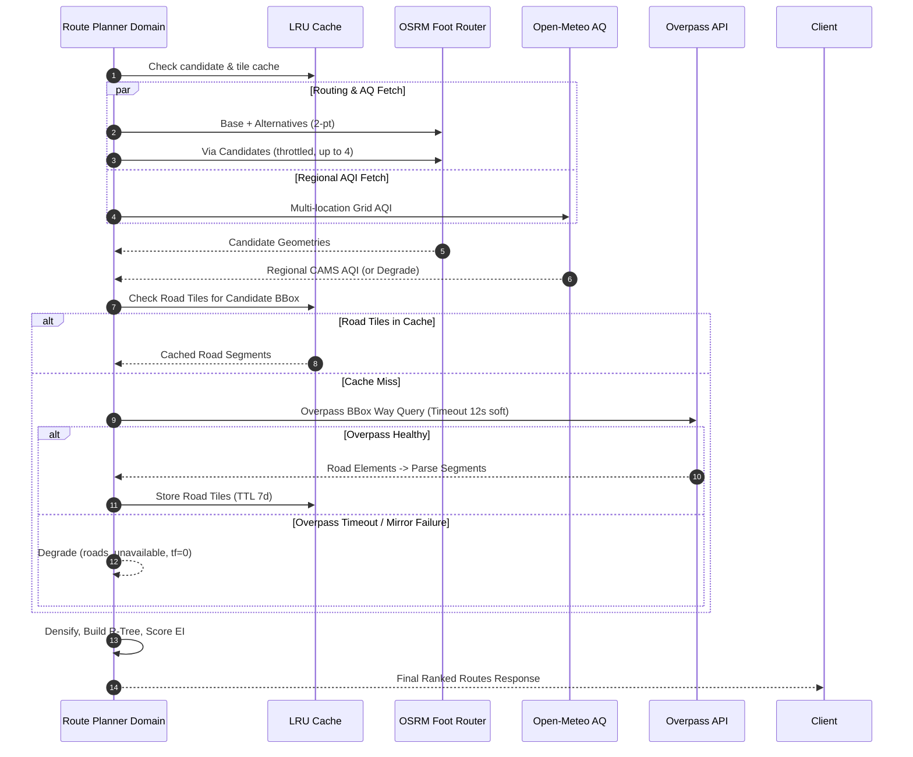

# BreatheWay — System Architecture & Technical Specifications

| Document Metadata | Details |
|---|---|
| **System** | BreatheWay — Eco-Route Air Quality Navigation Web App |
| **Document Version** | 1.0 (Implementation-Ready) |
| **Date** | 2026-10-14 |
| **Primary Audience** | AI Coding Agents (Antigravity), Software Architects, Full-Stack Engineers |
| **Companion Documents** | [PRD.md](file:///g:/work%20space/BioSolve-/PRD.md), [implementation-plan.md](file:///g:/work%20space/BioSolve-/implementation-plan.md), [build-rule.md](file:///g:/work%20space/BioSolve-/build-rule.md), [build-progress.md](file:///g:/work%20space/BioSolve-/build-progress.md) |

---

## 1. System Overview & Architectural Topology

BreatheWay is structured as a unified full-stack application built on Next.js 16 (App Router) executing on the Node.js 22 LTS runtime. It combines a client-side reactive map interface (Leaflet 1.9.4 + React Leaflet 5) with high-performance, stateless server-side route handlers (`/api/*`) and isolated pure domain scoring logic.

### 1.1 Architectural Component Diagram

```mermaid
flowchart TD
    subgraph Browser ["Client Browser (Evergreen Desktop & Mobile)"]
        UI["Next.js App Shell (React 19, Inter Font)"]
        Store["Zustand Store (planner-store.ts)"]
        Query["TanStack React Query v5 (Cache & In-Flight Abort)"]
        MapEngine["Leaflet 1.9.4 + React-Leaflet 5 (Dynamic SSR: false)"]
        LocalStorage[("HTML5 localStorage (bw:v1:recents, prefs)")]
        
        UI <--> Store
        UI <--> Query
        UI <--> MapEngine
        Store <--> LocalStorage
    end

    subgraph Server ["Next.js Server (Node.js 22 Runtime)"]
        RH["Route Handlers (src/app/api/*)"]
        Middleware["API Handler Envelope, Rate Limiter, Logger"]
        Domain["Domain Engine (src/server/domain/*)"]
        Cache[("In-Memory LRU Cache & Single-Flight Store")]
        Adapters["Provider Adapters (src/server/providers/*)"]
        
        RH --> Middleware
        Middleware --> Domain
        Domain <--> Cache
        Domain --> Adapters
    end

    subgraph External ["External Open APIs & Services"]
        Photon["Photon Geocoder (Komoot)"]
        Nominatim["OSM Nominatim Geocoder"]
        OSRM["OSRM Foot Router (FOSSGIS)"]
        OpenMeteo["Open-Meteo Air Quality (CAMS European/Global)"]
        Overpass["OSM Overpass API (Road Geometry)"]
        OSMTiles["OSM Tile Server (Raster Slippy Map Tiles)"]
    end

    Query -->|HTTPS JSON| RH
    MapEngine -->|Raster Tiles| OSMTiles
    Adapters -->|HTTPS GET| Photon
    Adapters -->|HTTPS GET (1 rps)| Nominatim
    Adapters -->|HTTPS GET| OSRM
    Adapters -->|HTTPS GET| OpenMeteo
    Adapters -->|HTTPS POST| Overpass
```

### 1.2 Boundary & Isolation Principles

1. **Strict Client/Server Separation:**
   - Every file within `src/server/**` begins with `import "server-only";`. Any accidental import into client components fails immediately at compile time.
   - Client components never make direct external API calls to upstream providers (OSRM, Open-Meteo, Overpass, Photon, Nominatim). All external traffic is mediated by server Route Handlers to eliminate CORS friction, enforce rate limits, prevent SSRF, and protect upstream fair-use quotas.
2. **Framework-Independent Domain Core:**
   - Code in `src/server/domain/**` contains purely functional TypeScript algorithms. It does not import `next/server`, `next/headers`, `Request`, or `Response`. It accepts strongly-typed plain JavaScript objects and returns plain JavaScript objects. This ensures domain logic is 100% testable in Vitest without HTTP mocking and can be ported to standalone Express or AWS Lambda without rewriting.
3. **Provider Adapter Abstraction:**
   - External services are hidden behind strict interface contracts (`GeocodingProvider`, `RoutingProvider`, `AqiProvider`, `RoadsProvider`). Upstream API quirks, XML/JSON parsing, pagination, coordinate order differences (`[lat, lon]` vs `[lon, lat]`), and error payloads are normalized inside adapters and never leak into domain models.
4. **Isomorphic Shared Utilities (`src/lib/**`):**
   - Pure mathematical calculations (geodesy, haversine, coordinate conversions), schemas (Zod), AQI categorization, and formatting helpers reside in `src/lib/**` and are safe to import on both client and server.

---

## 2. Technology Stack & Detailed Rationale

| Layer | Selection | Version Specification | Rationale & Architectural Constraints |
|---|---|---|---|
| **Runtime** | Node.js | `22 LTS` (`.nvmrc` = 22, `engines.node >= 22`) | Modern LTS runtime providing native `fetch`, native `AbortSignal.timeout`, and optimized V8 performance. |
| **Framework** | Next.js | `16.x (App Router)` | Full-stack unified repository; Route Handlers run on Node runtime (`export const runtime = "nodejs"`). |
| **Language** | TypeScript | `5.x` | `strict: true`, `noUncheckedIndexedAccess: true`. Zero untyped variables (`any` disallowed without written exception). |
| **UI Library** | React | `19.x` | Latest React engine with native Server Components and concurrent rendering. |
| **Styling** | Tailwind CSS & shadcn/ui | `Tailwind 4.x`, `@theme` token config | CSS-first token configuration in `globals.css`. Radix primitives for accessibility. Custom combobox per WAI-ARIA 1.2. |
| **Mapping Engine** | Leaflet & React-Leaflet | `Leaflet 1.9.4`, `react-leaflet 5.x` | OpenStreetMap standard. Loaded client-side only via `next/dynamic` (`ssr: false`). Leaflet 2.x alpha is prohibited due to react-leaflet incompatibility. |
| **Client State** | Zustand | `5.x` | Lightweight store for active trip endpoints, detour preference, and UI flags. |
| **Async Server State** | TanStack React Query | `5.x` | Auto-caching, deduplication, retry management, and native `AbortController` integration for in-flight route cancellation. |
| **Data Validation** | Zod | `4.x` | Unified runtime schema validation and compile-time TypeScript type inference for all API contracts and storage objects. |
| **Geospatial Math** | Custom `geo.ts` + rbush | `rbush 4.x` | In-memory 2D spatial R-Tree indexing for rapid road proximity queries. Pure TypeScript geodesy helpers. |
| **Server Cache** | lru-cache | `10.x` | In-memory Least-Recently-Used caching for geocode queries, AQI cells, road segments, and route candidates. |
| **Testing** | Vitest, MSW, Playwright, Axe | `Vitest 3.x`, `MSW 2.x`, `Playwright 1.x`, `@axe-core/playwright` | Multi-tier test pyramid: Unit, integration with network-level HTTP mocking, real-browser E2E, and automated WCAG 2.2 AA accessibility validation. |

---

## 3. Complete Data Contracts & Schemas (`src/lib/schemas.ts`)

All entities across client and server MUST strictly conform to the following Zod definitions:

```typescript
import { z } from "zod";

// ==========================================
// 1. Primitive Geospatial & Core Schemas
// ==========================================

export const LatLngSchema = z.object({
  lat: z.number().min(-90, "Latitude must be between -90 and 90").max(90),
  lng: z.number().min(-180, "Longitude must be between -180 and 180").max(180),
});

export const PlaceSchema = LatLngSchema.extend({
  label: z.string().trim().max(120, "Label cannot exceed 120 characters").optional(),
});

export const DetourLimitSchema = z.enum(["strict", "standard", "flexible"]);

export const AqiCategorySchema = z.enum([
  "good",
  "moderate",
  "usg",
  "unhealthy",
  "very_unhealthy",
  "hazardous",
]);

export const RouteTagSchema = z.enum(["fastest", "cleanest", "balanced"]);

// ==========================================
// 2. Route Computation API Contracts
// ==========================================

export const RoutesRequestSchema = z.object({
  origin: PlaceSchema,
  destination: PlaceSchema,
  detourLimit: DetourLimitSchema.default("standard"),
}).strict();

export const GeoJsonLineStringSchema = z.object({
  type: z.literal("LineString"),
  coordinates: z.array(z.tuple([z.number(), z.number()])).min(2),
});

export const RouteVsFastestSchema = z.object({
  extraSeconds: z.number().int(),
  extraMeters: z.number().int(),
  exposureReductionPct: z.number().nullable(),
});

export const RouteResultSchema = z.object({
  id: z.string().min(1),
  tags: z.array(RouteTagSchema).min(1),
  distanceM: z.number().nonnegative(),
  durationS: z.number().nonnegative(),
  avgExposure: z.number().nonnegative().nullable(),
  maxExposure: z.number().nonnegative().nullable(),
  exposureCategory: AqiCategorySchema.nullable(),
  nearTrafficPct: z.number().min(0).max(100).nullable(),
  vsFastest: RouteVsFastestSchema,
  geometry: GeoJsonLineStringSchema,
  exposure: z.array(z.number().int().nonnegative()).nullable(),
});

export const BackgroundAqiSchema = z.object({
  usAqi: z.number().min(0).max(500),
  category: AqiCategorySchema,
  pm25: z.number().nullable(),
  pm10: z.number().nullable(),
  no2: z.number().nullable(),
  observedAt: z.string().datetime(),
  source: z.literal("open-meteo-cams"),
  gridSamples: z.number().int().min(1),
});

export const RoutesMetaSchema = z.object({
  modelVersion: z.string(),
  exposureModel: z.string(),
  providers: z.object({
    routing: z.string(),
    aqi: z.string(),
    roads: z.string(),
  }),
  candidatesEvaluated: z.number().int(),
  degraded: z.array(z.string()),
  mocked: z.boolean(),
  cache: z.object({
    routing: z.enum(["hit", "miss"]),
    aqi: z.enum(["hit", "miss"]),
    roads: z.enum(["hit", "miss"]),
  }),
  computeMs: z.number().nonnegative(),
});

export const RoutesResponseSchema = z.object({
  requestId: z.string().min(1),
  generatedAt: z.string().datetime(),
  origin: PlaceSchema,
  destination: PlaceSchema,
  background: BackgroundAqiSchema.nullable(),
  recommendedRouteId: z.string().min(1),
  routes: z.array(RouteResultSchema).min(1).max(3),
  meta: RoutesMetaSchema,
});

// ==========================================
// 3. Geocoding API Contracts
// ==========================================

export const GeocodeResultItemSchema = z.object({
  id: z.string(),
  label: z.string().min(1),
  secondaryLabel: z.string().optional(),
  lat: z.number().min(-90).max(90),
  lng: z.number().min(-180).max(180),
  kind: z.string().optional(),
});

export const GeocodeResponseSchema = z.object({
  provider: z.enum(["photon", "nominatim"]),
  results: z.array(GeocodeResultItemSchema),
});

export const ReverseGeocodeResponseSchema = z.object({
  place: PlaceSchema.nullable(),
});

// ==========================================
// 4. Standalone Air Quality Contract
// ==========================================

export const AqiReadingSchema = z.object({
  usAqi: z.number().min(0).max(500),
  category: AqiCategorySchema,
  pm25: z.number().nullable(),
  pm10: z.number().nullable(),
  no2: z.number().nullable(),
  observedAt: z.string().datetime(),
  source: z.literal("open-meteo-cams"),
});

// ==========================================
// 5. Health Check API Contracts
// ==========================================

export const ProviderHealthCheckSchema = z.object({
  ok: z.boolean(),
  ms: z.number().nonnegative(),
  error: z.string().optional(),
});

export const HealthResponseSchema = z.object({
  status: z.enum(["ok", "degraded"]),
  version: z.string(),
  uptimeS: z.number().nonnegative(),
  mocked: z.boolean(),
  providers: z.record(z.string(), ProviderHealthCheckSchema).optional(),
});

// ==========================================
// 6. Unified Error Envelope Contract
// ==========================================

export const ErrorCodeSchema = z.enum([
  "VALIDATION_ERROR",
  "METHOD_NOT_ALLOWED",
  "PAYLOAD_TOO_LARGE",
  "ROUTE_TOO_SHORT",
  "ROUTE_TOO_LONG",
  "NO_ROUTE_FOUND",
  "RATE_LIMITED",
  "UPSTREAM_ERROR",
  "ROUTING_UNAVAILABLE",
  "AQI_UNAVAILABLE",
  "GEOCODING_UNAVAILABLE",
  "UPSTREAM_TIMEOUT",
  "INTERNAL",
]);

export const ErrorDetailIssueSchema = z.object({
  path: z.string(),
  message: z.string(),
});

export const ErrorEnvelopeSchema = z.object({
  error: z.object({
    code: ErrorCodeSchema,
    message: z.string(),
    details: z.object({
      issues: z.array(ErrorDetailIssueSchema).optional(),
      retryAfterSeconds: z.number().optional(),
    }).passthrough().optional(),
    requestId: z.string(),
  }),
});

// ==========================================
// 7. Client Storage Schemas (localStorage)
// ==========================================

export const RecentPlaceItemSchema = z.object({
  label: z.string(),
  lat: z.number(),
  lng: z.number(),
  ts: z.number(),
});

export const ClientRecentsStorageSchema = z.array(RecentPlaceItemSchema).max(8);

export const ClientPrefsStorageSchema = z.object({
  detourLimit: DetourLimitSchema.default("standard"),
});

// Type Inferences
export type LatLng = z.infer<typeof LatLngSchema>;
export type Place = z.infer<typeof PlaceSchema>;
export type DetourLimit = z.infer<typeof DetourLimitSchema>;
export type AqiCategory = z.infer<typeof AqiCategorySchema>;
export type RouteTag = z.infer<typeof RouteTagSchema>;
export type RoutesRequest = z.infer<typeof RoutesRequestSchema>;
export type RouteResult = z.infer<typeof RouteResultSchema>;
export type RoutesResponse = z.infer<typeof RoutesResponseSchema>;
export type GeocodeResultItem = z.infer<typeof GeocodeResultItemSchema>;
export type GeocodeResponse = z.infer<typeof GeocodeResponseSchema>;
export type ReverseGeocodeResponse = z.infer<typeof ReverseGeocodeResponseSchema>;
export type AqiReading = z.infer<typeof AqiReadingSchema>;
export type HealthResponse = z.infer<typeof HealthResponseSchema>;
export type ErrorCode = z.infer<typeof ErrorCodeSchema>;
export type ErrorEnvelope = z.infer<typeof ErrorEnvelopeSchema>;
export type RecentPlaceItem = z.infer<typeof RecentPlaceItemSchema>;
export type ClientPrefsStorage = z.infer<typeof ClientPrefsStorageSchema>;
```

---

## 4. API Specification & HTTP Protocols

### 4.1 Endpoint Directory

| Endpoint | Method | Rate Limit (per IP) | Timeout | Primary Purpose |
|---|---|---|---|---|
| `/api/routes` | `POST` | 10 / min | 28 s | Compute walking candidates, exposure scores, and rank routes. |
| `/api/geocode` | `GET` | 40 / min | 5 s | Typeahead place search (Photon) or explicit search (Nominatim). |
| `/api/geocode/reverse` | `GET` | 20 / min | 5 s | Reverse geocoding of coordinates to street address/landmark. |
| `/api/aqi` | `GET` | 30 / min | 5 s | Standalone current air quality reading for a point. |
| `/api/health` | `GET` | Unlimited (`?deep=1`: 5/min) | 5 s | Liveness check; deep check verifies upstream external providers. |

### 4.2 Standard Headers & Response Envelope

Every API response emitted by `src/server/http/api-handler.ts` MUST include:
- `Content-Type: application/json; charset=utf-8`
- `X-Request-Id: <uuidv4_or_cuid>`
- `Server-Timing: routing;dur=..., aqi;dur=..., roads;dur=..., score;dur=..., total;dur=...`
- `Cache-Control: no-store` (except `/api/geocode` and `/api/geocode/reverse` which permit `private, max-age=300`)
- Rate limit headers: `X-RateLimit-Limit`, `X-RateLimit-Remaining`, `X-RateLimit-Reset`

---

## 5. Domain Algorithms & Mathematical Formats

All mathematical procedures reside in `src/lib/geo.ts` and `src/server/domain/**`.

### 5.1 Geodesic & Navigation Formulas

1. **Haversine Distance ($D$):**
   Given point 1 $(\phi_1, \lambda_1)$ and point 2 $(\phi_2, \lambda_2)$ in radians, and Earth radius $R = 6,371,000\text{ m}$:
   $$\Delta \phi = \phi_2 - \phi_1, \quad \Delta \lambda = \lambda_2 - \lambda_1$$
   $$a = \sin^2\left(\frac{\Delta \phi}{2}\right) + \cos(\phi_1)\cos(\phi_2)\sin^2\left(\frac{\Delta \lambda}{2}\right)$$
   $$c = 2 \cdot \operatorname{atan2}\left(\sqrt{a}, \sqrt{1-a}\right), \quad D = R \cdot c$$

2. **Forward Azimuth Bearing ($\theta$):**
   $$\theta = \operatorname{atan2}\left(\sin(\Delta \lambda)\cos(\phi_2), \cos(\phi_1)\sin(\phi_2) - \sin(\phi_1)\cos(\phi_2)\cos(\Delta \lambda)\right)$$
   Normalized to degrees $[0^\circ, 360^\circ)$.

3. **Great-Circle Destination Point:**
   Given start point $(\phi_1, \lambda_1)$, initial bearing $\theta$, and distance $d$:
   $$\delta = \frac{d}{R}$$
   $$\phi_2 = \arcsin\left(\sin(\phi_1)\cos(\delta) + \cos(\phi_1)\sin(\delta)\cos(\theta)\right)$$
   $$\lambda_2 = \lambda_1 + \operatorname{atan2}\left(\sin(\theta)\sin(\delta)\cos(\phi_1), \cos(\delta) - \sin(\phi_1)\sin(\phi_2)\right)$$

### 5.2 Planar Point-to-Segment Distance in Local Equirectangular Projection

For calculating distance $d(P, AB)$ from point $P$ to road segment $AB$ at walking scales ($< 500\text{ m}$):
1. Compute mean latitude $\phi_m = \frac{\phi_P + \phi_A + \phi_B}{3}$.
2. Project $P, A, B$ into local Cartesian coordinates $(x, y)$ in meters:
   $$x = \lambda \cdot R \cdot \cos(\phi_m), \quad y = \phi \cdot R$$
3. Let segment vector $\mathbf{v} = B - A$ and point vector $\mathbf{u} = P - A$:
   $$t = \operatorname{clamp}\left(\frac{\mathbf{u} \cdot \mathbf{v}}{\|\mathbf{v}\|^2}, 0, 1\right)$$
4. Distance $d = \|P - (A + t \cdot \mathbf{v})\|$.

### 5.3 Polyline Densification (`densify`)

To avoid sparse routing vertices bypassing road buffers:
- Iterate through each line segment $[P_i, P_{i+1}]$ of the candidate route.
- If $d(P_i, P_{i+1}) > 50\text{ m}$, calculate required divisions $n = \lceil d / 50 \rceil$.
- Interpolate $n-1$ intermediate points linearly in Cartesian space.
- Original vertices are strictly preserved to maintain exact intersection geometry.

### 5.4 Symmetric Polyline Deduplication

Two candidate polylines $A$ and $B$ (both densified at $50\text{ m}$) are duplicates if and only if:
1. $\ge 90\%$ of vertices in $A$ are within $20\text{ m}$ of polyline $B$, **AND**
2. $\ge 90\%$ of vertices in $B$ are within $20\text{ m}$ of polyline $A$.
When a duplicate pair is detected, the candidate with the lower duration is retained.

### 5.5 Exposure Index (EI) Formula

$$\text{EI}(p) = \operatorname{clamp}\left(\text{bg}(p) \cdot \left(1 + \alpha \cdot \text{tf}(p)\right), 0, 500\right)$$
Where:
- $\alpha = 0.8$ (`roadsideUplift`): maximum 80% uplift near major roads.
- $\text{bg}(p)$: Background US AQI computed via 2D Inverse Distance Weighting (IDW) from the $3 \times 3$ grid samples:
  $$\text{bg}(p) = \frac{\sum_i w_i \cdot \text{AQI}_i}{\sum_i w_i}, \quad w_i = \frac{1}{\max(d(p, s_i), 1000\text{ m})^2}$$
- $\text{tf}(p)$: Traffic factor computed against all road segments $r$ indexed in the R-tree within search radius $R_{\text{search}} = 250\text{ m}$:
  $$\text{tf}(p) = \max_{r \in \text{roads}, d(p, r) \le 250} \left( W(r) \cdot \exp\left(-\frac{d(p, r)}{60}\right) \right)$$
  With road class weights $W(r)$:
  - `motorway`: 1.0
  - `trunk`: 1.0
  - `primary`: 0.85
  - `secondary`: 0.65
  - `tertiary`: 0.40
  - Any `*_link` road: $0.8 \times \text{parent weight}$

### 5.6 Route Selection Rules

1. **Fastest Route:** Candidate with $\min(\text{durationS})$.
2. **Detour Filter:** Candidate allowed if and only if:
   $$\text{durationS} \le \max\left(\text{fastest.durationS} \cdot (1 + p), \text{fastest.durationS} + 120\right)$$
   **AND**
   $$\text{durationS} - \text{fastest.durationS} \le 1200\text{ s} \quad (20\text{ min cap})$$
   Where $p = 0.15$ (Strict), $0.30$ (Standard), $0.50$ (Flexible).
3. **Cleanest Route:** Candidate in allowed set with $\min(\text{avgExposure})$.
   - Compute exposure reduction:
     $$\Delta \text{EI}\% = \operatorname{round}\left(\frac{\text{fastest.avgExposure} - \text{cleanest.avgExposure}}{\text{fastest.avgExposure}} \cdot 100\right)$$
   - If $\Delta \text{EI}\% < 3\%$ or cleanest is identical to fastest: return single route with tags `["fastest", "cleanest"]`.
4. **Balanced Route:** Evaluated among remaining allowed candidates:
   $$\text{cost} = 0.5 \cdot \left(\frac{\text{durationS}}{\text{fastest.durationS}}\right) + 0.5 \cdot \left(\frac{\text{avgExposure}}{\text{fastest.avgExposure}}\right)$$
   Included only if $\text{cost} < 1.0$ and reduction vs fastest $\ge 2\%$.

---

## 6. Third-Party Integrations & Resilience



### 6.1 Integration Specification Table

| Service | Protocol / Endpoint | Auth | Throttling & Concurrency | Timeout & Retries | Failure Strategy |
|---|---|---|---|---|---|
| **Photon** | `GET https://photon.komoot.io/api/?q=...` | None | Fair use | 4 s / 1 retry | Typeahead fails: return 503 `GEOCODING_UNAVAILABLE`; user prompted to tap map. |
| **Nominatim** | `GET https://nominatim.openstreetmap.org/search?q=...` | None | Strict: **max 1 req/sec** via serialized async queue; identifying User-Agent mandatory. | 5 s / 0 retries | Explicit search fails: fall back to Photon. Reverse fails: return fallback pin label. |
| **OSRM Foot** | `GET https://routing.openstreetmap.de/routed-foot/route/v1/driving/...` | None | Max 2 concurrent requests; 250 ms delay between starts. | 8 s / 1 retry | Base request fails: return 503 `ROUTING_UNAVAILABLE`. Via failures: ignore individual via candidates. |
| **Open-Meteo AQ** | `GET https://air-quality-api.open-meteo.com/v1/air-quality?latitude=...&current=us_aqi...` | None (Non-commercial) | Fair use | 5 s / 1 retry | Fails: return HTTP 200 with fastest route only, `meta.degraded = ["aqi_unavailable"]`. |
| **Overpass** | `POST https://overpass-api.de/api/interpreter` (Mirror: `overpass.private.coffee`) | None | Max 2 concurrent tile fetches. | 25 s hard, **12 s soft deadline** / 1 mirror failover | Fails: score route using background AQI only ($tf = 0$), `meta.degraded = ["roads_unavailable"]`. |

---

## 7. Storage & In-Memory Caching Architecture

### 7.1 Client `localStorage` Specifications

- **Key `bw:v1:recents`**: Holds array of up to 8 unique places (`Array<{ label, lat, lng, ts }>`). De-duplicated by coordinates rounded to 5 decimal places. Wrapped in try/catch; disabled storage does not throw.
- **Key `bw:v1:prefs`**: Holds `{ detourLimit: "strict" | "standard" | "flexible" }`.

### 7.2 Server In-Memory LRU Cache Structure

Implemented in `src/server/cache/lru-cache-store.ts` via `lru-cache`:

| Cache Domain | Key Format | Max Entries | TTL | Single-Flight Guaranteed |
|---|---|---|---|---|
| **Geocode Search** | `geo:s:{provider}:{normalizedQ}:{lat1}:{lng1}:{limit}` | 500 | 24 hours | Yes |
| **Geocode Reverse** | `geo:r:{lat4}:{lng4}` | 500 | 24 hours | Yes |
| **AQI Cell** | `aqi:{lat2}:{lng2}` (0.01° cell) | 500 | 30 minutes | Yes |
| **Candidates** | `cand:{o4}:{d4}` (4-decimal coordinates) | 300 | 6 hours | Yes |
| **Road Tiles** | `roads:t:{latIdx}:{lngIdx}` (0.05° tile index) | 80 | 7 days | Yes |

*Single-flight mechanism:* In-flight asynchronous promises are tracked by key in a `Map<string, Promise<T>>`. Identical concurrent requests await the active promise rather than issuing multiple parallel upstream fetches.

---

## 8. Security Controls & Threat Mitigation

1. **Content Security Policy (CSP):**
   Enforced in production via `next.config.ts`:
   ```
   default-src 'self';
   script-src 'self' 'unsafe-inline';
   style-src 'self' 'unsafe-inline';
   img-src 'self' data: https://tile.openstreetmap.org;
   font-src 'self';
   connect-src 'self';
   frame-ancestors 'none';
   base-uri 'self';
   form-action 'self';
   object-src 'none';
   ```
2. **SSRF Prevention:**
   Base URLs for all upstream APIs are loaded strictly from validated environment variables. User inputs are restricted to numerical coordinates or sanitized strings injected exclusively into URLSearchParams.
3. **Overpass Query Injection Defense:**
   Overpass QL queries are assembled strictly from validated numerical bounding boxes:
   `[out:json][timeout:25];way["highway"~"^(motorway|trunk|primary|secondary|tertiary)(_link)?$"]["tunnel"!="yes"](${south},${west},${north},${east});out geom;`
4. **Input Size & Range Bounds:**
   - Request bodies capped at 8 KB.
   - Max straight-line distance capped at 15 km (`ROUTE_TOO_LONG`).
   - Min straight-line distance capped at 50 m (`ROUTE_TOO_SHORT`).
5. **Zero-PII Privacy Protection:**
   - Coordinates logged to stdout are truncated to 2 decimal places ($\approx 1.1\text{ km}$ resolution).
   - Client IP addresses are processed in volatile memory solely for sliding-window rate limiting and are never written to disk or logs.
