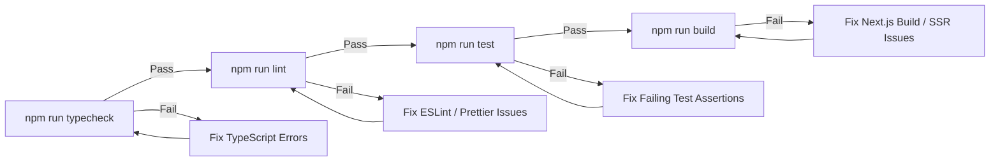

# Antigravity AI Coding Agent — Build Rules & Execution Guardrails

| Metadata | Details |
|---|---|
| **System** | BreatheWay — Eco-Route Air Quality Navigation Web App |
| **Applicability** | Mandatory for all agentic coding sessions in Google Antigravity |
| **Workspace Root** | `g:\work space\BioSolve-` (Working directory: `./`) |
| **Companion Documents** | [PRD.md](file:///g:/work%20space/BioSolve-/PRD.md), [architecture.md](file:///g:/work%20space/BioSolve-/architecture.md), [implementation-plan.md](file:///g:/work%20space/BioSolve-/implementation-plan.md), [build-progress.md](file:///g:/work%20space/BioSolve-/build-progress.md) |

---

## 1. Core Operating Principles

As an AI coding agent pair-programming in Antigravity, you must adhere strictly to these operational guardrails:

### Rule 1.1: Root Workspace Directory Discipline
- The project files MUST reside directly in the workspace root (`./`).
- **NEVER** initialize or scaffold the project inside a nested subdirectory like `breatheway/` or `app/`. The `package.json`, `.env.example`, `tsconfig.json`, and `src/` directory must be located directly at `g:\work space\BioSolve-\`.

### Rule 1.2: Single Source of Truth
- [PRD.md](file:///g:/work%20space/BioSolve-/PRD.md) and [architecture.md](file:///g:/work%20space/BioSolve-/architecture.md) are the primary sources of truth.
- Do NOT invent unapproved features, add superfluous third-party frameworks (e.g., Redux, Prisma, Express, Docker Compose in MVP), or alter the Exposure Index formula.
- If an unavoidable ambiguity or upstream provider limitation arises, document the discrepancy in `docs/deviations.md` and consult [build-progress.md](file:///g:/work%20space/BioSolve-/build-progress.md).

### Rule 1.3: Real Data in the Production Flow (Zero Placeholders)
- Production runtime paths MUST fetch real data from the live open providers:
  - Geocoding: Photon (`https://photon.komoot.io`) and Nominatim (`https://nominatim.openstreetmap.org`)
  - Routing: FOSSGIS OSRM foot router (`https://routing.openstreetmap.de/routed-foot/`)
  - Air Quality: Open-Meteo Air Quality API (`https://air-quality-api.open-meteo.com`)
  - Roads: OpenStreetMap Overpass API (`https://overpass-api.de/api/interpreter`)
- Mocks (`USE_MOCK_PROVIDERS=true`) are strictly restricted to automated tests (Playwright/Vitest) and offline dev. If `NODE_ENV=production` and `USE_MOCK_PROVIDERS=true`, the server MUST throw an initialization error.
- Every button, dropdown, modal, sheet, and input documented in PRD §8 and §9 must be completely wired to application state. Dummy `console.log` handlers or disabled placeholders are unacceptable.

---

## 2. Architectural Boundaries & Code Isolation

### Rule 2.1: Server-Side Module Protection
- Every file created under `src/server/**` MUST start with:
  ```typescript
  import "server-only";
  ```
- Client components (`"use client"`) MUST NEVER import from `src/server/**`. Violating this will trigger build failures.

### Rule 2.2: Pure Domain Logic Isolation
- Code under `src/server/domain/**` (`route-planner.ts`, `candidates.ts`, `dedupe.ts`, `exposure.ts`, `road-index.ts`, `select.ts`) MUST remain completely framework-agnostic.
- Domain modules MUST NOT import from `next/server`, `next/headers`, or Node HTTP primitives. They accept typed domain inputs and return typed domain outputs.

### Rule 2.3: Provider Adapter Isolation
- Code under `src/server/providers/**` MUST encapsulate all provider-specific HTTP headers, rate-limiting delays, XML/JSON parsers, and coordinate ordering (`[lat, lon]` vs `[lon, lat]`).
- Adapters MUST normalize raw provider responses into internal TypeScript interfaces before returning to the domain layer.

### Rule 2.4: Leaflet & Client Map Safety
- Leaflet requires the browser DOM (`window`, `document`).
- Map components MUST be loaded dynamically with SSR disabled:
  ```typescript
  // src/components/map/MapContainerLazy.tsx
  import dynamic from "next/dynamic";
  
  export const MapContainerLazy = dynamic(
    () => import("./MapView").then((mod) => mod.MapView),
    { ssr: false, loading: () => <MapLoadingSkeleton /> }
  );
  ```
- Never use Leaflet default marker images (which fail to load under Next.js asset bundling). Use `L.divIcon` with custom inline SVGs and Tailwind classes.

---

## 3. Mandatory Test-and-Fix Loop

After making any substantial code modification, the agent MUST run the verification pipeline in strict order:



### Prohibited Practices
- **DO NOT** use `@ts-ignore` or `@ts-nocheck` to bypass compiler errors. Fix the underlying type mismatch.
- **DO NOT** use `eslint-disable` without an explicit comment explaining why an exception is required.
- **DO NOT** comment out failing tests or reduce test assertions to force a passing status.
- **DO NOT** commit unformatted code. Prettier and ESLint rules must pass cleanly.

---

## 4. Upstream Provider Etiquette & Policy Compliance

1. **Nominatim Policy Enforcement:**
   - Nominatim requests MUST be serialized through an async queue enforcing a minimum of **1000 ms** between request starts.
   - Nominatim MUST never be invoked on typeahead keypresses. Typeahead queries Photon exclusively.
   - All upstream requests MUST send an identifying `User-Agent`:
     `${UPSTREAM_USER_AGENT}` (e.g., `BreatheWay/1.0 (contact: you@example.com)`).
2. **OSRM Foot Routing:**
   - Always route using the `/routed-foot/` prefix on the FOSSGIS demo server.
   - Limit concurrent OSRM requests to $\le 2$ with $\ge 250\text{ ms}$ spacing.
3. **Overpass Tiling & Deadlines:**
   - Divide candidate bounding boxes into $0.05^\circ$ aligned tiles.
   - Enforce an overall **12-second soft deadline** on the road fetch step. If Overpass fails or exceeds 12 seconds, gracefully degrade to regional-only exposure scoring (`roads_unavailable`) rather than failing the user's route calculation.

---

## 5. UI/UX & Design System Constraints

1. **Theme & Styling:**
   - Use CSS variables defined in `@theme` inside `src/app/globals.css`.
   - Maintain the specified color palette:
     - Primary brand: `#0F766E` (`--bw-brand-700`)
     - Background: `#F8FAFC` (`--bw-bg`)
     - Text: `#0F172A` (`--bw-text`)
     - Muted: `#475569` (`--bw-text-muted`)
   - All interactive text must maintain WCAG 2.2 AA contrast ($\ge 4.5:1$).
2. **Accessible Interaction:**
   - Search inputs MUST implement WAI-ARIA 1.2 combobox pattern with `aria-expanded`, `aria-autocomplete="list"`, `aria-controls`, and `aria-activedescendant`.
   - Results MUST announce via an `aria-live="polite"` region.
   - Minimum touch target for all buttons and interactive controls: $44 \times 44\text{ px}$.
   - All animations must be disabled under `@media (prefers-reduced-motion: reduce)`.

---

## 6. Context Checkpoints & Session Resumption

When an Antigravity agent approaches context length limits or is resumed across conversation boundaries:

1. **Check State Ledger:** Read [build-progress.md](file:///g:/work%20space/BioSolve-/build-progress.md) to inspect the current completed phase, verified features, and pending tasks.
2. **Run Quick Smoke Verification:**
   ```bash
   npm run typecheck && npm run test
   ```
3. **Resume at Active Phase:** Pick up tasks exactly where the previous turn concluded, adhering to the phase dependencies outlined in [implementation-plan.md](file:///g:/work%20space/BioSolve-/implementation-plan.md).
4. **Update Progress Ledger:** Upon completing a task or phase, update [build-progress.md](file:///g:/work%20space/BioSolve-/build-progress.md) with test results and git commit hashes.
