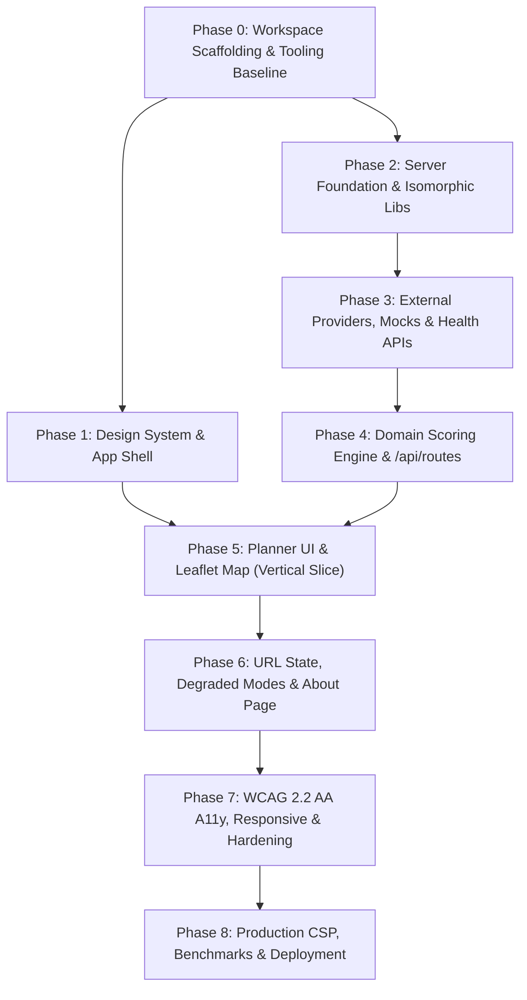

# BreatheWay — Phased Implementation Plan & Traceability Roadmap

| Document Metadata | Details |
|---|---|
| **System** | BreatheWay — Eco-Route Air Quality Navigation Web App |
| **Document Version** | 1.0 (Implementation-Ready) |
| **Date** | 2026-10-14 |
| **Target Audience** | Antigravity AI Coding Agent, Tech Lead, Engineering Team |
| **Companion Documents** | [PRD.md](file:///g:/work%20space/BioSolve-/PRD.md), [architecture.md](file:///g:/work%20space/BioSolve-/architecture.md), [build-rule.md](file:///g:/work%20space/BioSolve-/build-rule.md), [build-progress.md](file:///g:/work%20space/BioSolve-/build-progress.md) |

---

## 1. Execution Roadmap Overview

The implementation is structured into 9 sequential, dependency-ordered phases (Phase 0 to Phase 8). A fully demonstrable, interactive vertical slice is achieved at the conclusion of **Phase 5**.



---

## 2. Phase-by-Phase Task Breakdown & Verification Gates

### Phase 0: Workspace Scaffolding & Tooling Baseline
- **Goal:** Establish a pristine Next.js 16 + React 19 + TypeScript project baseline in `./`.
- **Prerequisites:** Node.js 22 LTS, npm, clean git working tree on branch `feat/mvp`.
- **Tasks:**
  1. Inspect root directory; scaffold Next.js 16 in `./` using TypeScript, ESLint, Tailwind CSS, App Router, `src/` directory, and path alias `@/*`.
  2. Create `.nvmrc` containing `22`, set `package.json` engines to `"node": ">=22.0.0"`.
  3. Install core dependencies: `leaflet@1.9.4`, `react-leaflet@5.0.0`, `@types/leaflet@1.9.16`, `zod@^4.0.0`, `zustand@^5.0.0`, `@tanstack/react-query@^5.0.0`, `lucide-react`, `rbush@^4.0.0`, `lru-cache@^10.0.0`, `server-only`.
  4. Install dev/test tooling: `vitest`, `@testing-library/react`, `jsdom`, `msw@^2.0.0`, `@playwright/test`, `@axe-core/playwright`, `tsx`.
  5. Configure Vitest (`vitest.config.ts`) with alias for `server-only` to an empty mock module for unit testing.
  6. Populate `.env.example` with documented environment defaults.
  7. Initialize `docs/deviations.md` (empty baseline).
- **Verification Commands:**
  ```bash
  node -v
  npm run typecheck
  npm run lint
  npm run build
  ```
- **Definition of Done Gate:** Build compiles with zero errors, zero warnings, and clean git commit on `feat/mvp`.

---

### Phase 1: Design System & App Shell
- **Goal:** Implement the visual design system, typography, color tokens, and root layouts.
- **Tasks:**
  1. Implement CSS design tokens in `src/app/globals.css` with Tailwind 4 `@theme` (brand teals `#0F766E`, neutrals, semantic statuses, US AQI colors).
  2. Configure Inter font in `src/app/layout.tsx` via `next/font/google` (`display: "swap"`).
  3. Create root layout with skip links ("Skip to results", "Skip to map"), `<Providers>` (React Query + Sonner Toaster).
  4. Implement `Header.tsx` (logo, Wind icon, "How it works" link to `/about`).
  5. Build reusable visual primitives: `StatusBanner.tsx`, `Chip.tsx`, `AqiBadge.tsx`, `Skeleton.tsx`.
  6. Add shell pages: `src/app/page.tsx` (shell), `src/app/about/page.tsx` (placeholder), `not-found.tsx`, `error.tsx`, `global-error.tsx`.
- **Verification Commands:**
  ```bash
  npm run dev # Verify / and /about render visually
  npm run test # Verify color token contrast unit tests (T-36)
  ```
- **Definition of Done Gate:** Headers and layouts render seamlessly at mobile (375px) and desktop (1280px) breakpoints; WCAG contrast checks pass.

---

### Phase 2: Server Foundation & Isomorphic Shared Libraries
- **Goal:** Build the runtime validation schemas, geospatial helpers, and server utilities.
- **Tasks:**
  1. Create `src/lib/schemas.ts` defining all Zod schemas specified in [architecture.md §3](file:///g:/work%20space/BioSolve-/architecture.md#3-complete-data-contracts--schemas-srclibschemasts).
  2. Implement `src/lib/aqi.ts` with US AQI breakpoints, categorization, and color mapping.
  3. Implement `src/lib/geo.ts` with Haversine distance, forward azimuth bearing, great-circle destination point, densification, equirectangular point-to-segment distance, and symmetric polyline deduplication.
  4. Implement `src/lib/exposure-config.ts` exporting immutable `EXPOSURE_CONFIG`.
  5. Implement `src/lib/format.ts` (distance, duration, time formatters).
  6. Implement `src/lib/storage.ts` for safe `localStorage` access (`bw:v1:recents`, `bw:v1:prefs`).
  7. Implement `src/server/config/env.ts` with Zod validation of server environment variables.
  8. Implement `src/server/http/api-handler.ts` (unified error envelope, `X-Request-Id`, `Server-Timing`, rate limiting).
  9. Implement `src/server/cache/lru-cache-store.ts` with in-memory TTL caching and single-flight async deduplication.
- **Verification Commands:**
  ```bash
  npx vitest run tests/unit/geo.test.ts
  npx vitest run tests/unit/aqi.test.ts
  npx vitest run tests/unit/cache.test.ts
  ```
- **Definition of Done Gate:** Unit tests T-01 through T-05, T-21, T-24, and T-33 pass with $\ge 80\%$ line coverage on `src/lib/**`.

---

### Phase 3: External Provider Adapters, Mocks & Health APIs
- **Goal:** Implement resilient adapters for Photon, Nominatim, OSRM, Open-Meteo, and Overpass with full degradation support.
- **Tasks:**
  1. Build `PhotonAdapter` and `NominatimAdapter` with strict 1 req/sec serialized queue in `src/server/providers/geocoding/`.
  2. Build `OsrmFootAdapter` with concurrency throttle ($\le 2$, $\ge 250\text{ ms}$ spacing) and `/routed-foot/` prefix in `src/server/providers/routing/`.
  3. Build `OpenMeteoAqiAdapter` for multi-location CAMS AQI in `src/server/providers/aqi/`.
  4. Build `OverpassRoadsAdapter` with $0.05^\circ$ tiling, mirror failover (`overpass-api.de` $\rightarrow$ `overpass.private.coffee`), and 12-second soft deadline in `src/server/providers/roads/`.
  5. Implement mock provider suite in `src/server/providers/mock/` enabled via `USE_MOCK_PROVIDERS=true`.
  6. Implement Route Handlers:
     - `src/app/api/geocode/route.ts` (GET)
     - `src/app/api/geocode/reverse/route.ts` (GET)
     - `src/app/api/aqi/route.ts` (GET)
     - `src/app/api/health/route.ts` (GET, with `?deep=1` provider ping)
- **Verification Commands:**
  ```bash
  npx vitest run tests/integration/adapters.test.ts
  npx vitest run tests/integration/health.test.ts
  ```
- **Definition of Done Gate:** All adapters normalize raw external payloads into internal domain models; failure scenarios trigger correct degraded codes or error envelopes; MSW fixtures cover network failure paths.

---

### Phase 4: Domain Scoring Engine & Route Planning API
- **Goal:** Implement the multi-candidate walking generator, R-tree road proximity index, and exposure scoring algorithm.
- **Tasks:**
  1. Build `candidates.ts`: generate base route + OSRM alternatives + perpendicular via-routes ($f \in [0.2, 0.4]$, $\theta \pm 90^\circ$); apply spur filter to drop double-back paths; symmetric deduplication.
  2. Build `road-index.ts`: load Overpass road segments into `rbush` R-tree spatial index.
  3. Build `exposure.ts`: inverse distance weighting (IDW) for regional background AQI; compute exponential road traffic proximity factor $tf(p) = \max(W(r) \cdot \exp(-d/60))$; compute vertex $\text{EI}(p) = \text{bg}(p) \cdot (1 + 0.8 \cdot tf(p))$; calculate length-weighted `avgExposure`, `maxExposure`, and `nearTrafficPct`.
  4. Build `select.ts`: filter candidates by detour preset; select fastest, cleanest, and balanced routes; enforce minimum 3% reduction rule.
  5. Build `route-planner.ts`: orchestrate pipeline; measure execution timings; attach `meta` object.
  6. Wire `src/app/api/routes/route.ts` (POST) to domain engine.
- **Verification Commands:**
  ```bash
  npx vitest run tests/unit/domain.test.ts
  npx vitest run tests/integration/routes-api.test.ts
  ```
- **Definition of Done Gate:** Route API returns valid §13.2 response with invariants verified; tests T-04 through T-17, T-20 pass; domain test line coverage $\ge 80\%$.

---

### Phase 5: Planner UI & Interactive Map (Vertical Slice)
- **Goal:** Connect client state, search forms, and Leaflet map into a fully operational trip planner.
- **Tasks:**
  1. Implement `src/stores/planner-store.ts` (Zustand) managing origin, destination, detour limit, selection, pickMode, sheet state.
  2. Implement data hooks (`useGeocodeSearch`, `useReverseGeocode`, `useAqi`, `useRouteMutation`, `useGeolocation`).
  3. Build `LocationInput.tsx`: WAI-ARIA 1.2 combobox, debounced typeahead, recent places dropdown, locate button, pick-on-map button, clear button.
  4. Build `SearchForm.tsx`: origin/destination inputs, swap button, `DetourSelector.tsx` (strict, standard, flexible), submit button with loading spinner.
  5. Build `MapView.tsx` and `MapContainerLazy.tsx`: OSM raster tiles, custom `L.divIcon` markers A (teal) and B (slate), selected route colored runs by AQI category with white casing, unselected routes in muted slate, fitBounds with padding.
  6. Build `PickModeHandler.tsx` with map crosshair cursor and Escape cancel.
  7. Build `ResultsPanel.tsx` and `RouteCard.tsx`: tags (Zap, Leaf, Scale), metrics, trade-off comparison versus fastest, expandable details.
  8. Build `MobileSheet.tsx` for responsive mobile layout ($< 1024\text{ px}$).
  9. Add `AqiLegend.tsx` and live screen-reader announcement (`aria-live="polite"`).
- **Verification Commands:**
  ```bash
  npm run dev # Test end-to-end trip comparison in browser
  npx vitest run tests/component/
  npx playwright test tests/e2e/golden-path.spec.ts
  ```
- **Definition of Done Gate:** Golden path J1 (search places $\rightarrow$ view fastest vs cleanest routes $\rightarrow$ toggle selection $\rightarrow$ view metrics) functions flawlessly in browser.

---

### Phase 6: URL State, Degraded Modes & About Page
- **Goal:** Add deep-link sharing, browser navigation sync, graceful degradation notices, and the methodology page.
- **Tasks:**
  1. Implement `useUrlSync.ts` in `src/hooks/` supporting query parameters `?o=...&d=...&on=...&dn=...&dl=...`. Auto-run calculation when origin and destination are present; sync router state via `router.push` (submit) and `router.replace` (detour change).
  2. Build `CopyLinkButton.tsx` with clipboard copy and live region announcement.
  3. Wire degraded mode warning banners in `StatusBanner.tsx` for `aqi_unavailable`, `roads_unavailable`, `alternatives_unavailable`, and `mocked`.
  4. Implement full `src/app/about/page.tsx` with sections: How BreatheWay works, Methodology (#methodology, formula, worked example, parameters dynamically imported from `src/lib/exposure-config.ts`), Data Sources & Licenses, Limitations, Privacy (#privacy), and SDG 3 alignment.
  5. Finalize `not-found.tsx` and `error.tsx` boundary handling.
- **Verification Commands:**
  ```bash
  npx vitest run tests/unit/url-state.test.ts
  npx playwright test tests/e2e/deep-links.spec.ts
  npx playwright test tests/e2e/degraded-modes.spec.ts
  ```
- **Definition of Done Gate:** Deep links restore planner state; degraded conditions render appropriate banners without crashing; `/about` displays verified shared parameters.

---

### Phase 7: Accessibility, Responsive Polish & Test Hardening
- **Goal:** Ensure WCAG 2.2 AA compliance, keyboard navigability, responsive fluidity, and rigorous test coverage.
- **Tasks:**
  1. Conduct full keyboard accessibility audit (Tab, Shift+Tab, Arrow keys, Enter, Escape across all interactive controls).
  2. Implement automated accessibility test suite with `@axe-core/playwright` scanning `/` (empty and results states) and `/about`.
  3. Test viewports across 375×812 (mobile bottom sheet), 768×1024 (tablet), and 1280×800 (desktop side panel); assert zero horizontal overflow.
  4. Implement `@media (prefers-reduced-motion: reduce)` disabling all Leaflet transitions and CSS animations.
  5. Run test coverage reporting to verify $\ge 80\%$ line coverage across `src/server/domain` and `src/lib`.
  6. Generate traceability verification script (`scripts/traceability.ts`).
- **Verification Commands:**
  ```bash
  npm run test:coverage
  npm run test:e2e
  npm run lint
  npm run typecheck
  ```
- **Definition of Done Gate:** 0 serious or critical axe violations; all unit, integration, and E2E tests pass cleanly.

---

### Phase 8: Production CSP, Benchmarks & Deployment Readiness
- **Goal:** Configure production security headers, containerization, and benchmark validation.
- **Tasks:**
  1. Configure strict Content Security Policy (CSP), HSTS, and frame protections in `next.config.ts`.
  2. Create production multi-stage `Dockerfile` (`node:22-alpine`, non-root user, standalone Next.js output).
  3. Create `scripts/benchmark.ts` evaluating 20 origin-destination pairs to measure cold vs warm latencies (M1/M2) and exposure reduction statistics (M4).
  4. Create `scripts/live-smoke.ts` verifying live external providers and asserting walking speed plausibility (3–7 km/h).
  5. Finalize `README.md` with setup instructions, environment variables, and limitations.
- **Verification Commands:**
  ```bash
  npm run build
  npm run smoke:live # (if network permits)
  npm run benchmark  # (if network permits)
  ```
- **Definition of Done Gate:** Production build passes release gates specified in [PRD §24.2](file:///g:/work%20space/BioSolve-/PRD.md#242-mvp-release-gate).

---

## 3. Requirement-to-Test Traceability Matrix

Every functional requirement (`FR-xx.y`), non-functional requirement (`NFR-xx`), and acceptance criterion (`AC-xx.y`) maps directly to automated test suites:

| Requirement ID | Description | Verifying Test Suite / Test ID | Verification Type |
|---|---|---|---|
| **FR-01.1–01.5** | Place search combobox, debounce, Photon/Nominatim routing | `tests/component/LocationInput.test.tsx`, `T-18`, `T-19` | Component / Unit |
| **FR-01.6** | Geolocation start point & permission handling | `tests/component/LocationInput.test.tsx`, `T-34` | Component |
| **FR-01.7** | Pick-on-map mode & reverse geocode | `tests/component/PickModeHandler.test.tsx`, `T-29` | Component / E2E |
| **FR-01.8–01.10** | Swap inputs, clear button, local recents | `tests/component/SearchForm.test.tsx`, `T-26`, `T-33` | Component / Unit |
| **FR-02.1–02.2** | Distance validation (50m to 15km) | `tests/integration/routes-api.test.ts`, `T-15` | Integration |
| **FR-02.3–02.5** | Route candidate scoring, ranking, 3% threshold | `tests/unit/domain.test.ts`, `T-06`, `T-07` | Unit |
| **FR-02.6** | Abort in-flight requests & duplicate submission prevention | `tests/integration/routes-api.test.ts`, `T-21` | Integration |
| **FR-02.7** | Graceful degradation on upstream failure | `tests/integration/routes-api.test.ts`, `T-11`, `T-12`, `T-14` | Integration |
| **FR-03.1–03.8** | Leaflet map rendering, divIcons, AQI polylines, viewport bounds | `tests/e2e/map-visual.spec.ts`, `T-25`, `T-31` | E2E |
| **FR-04.1–04.5** | Route comparison cards, trade-off text, aria-live announcements | `tests/component/ResultsPanel.test.tsx`, `T-25`, `T-29` | Component |
| **FR-05.1–05.3** | Detour limit presets (strict, standard, flexible) & re-run | `tests/unit/select.test.ts`, `tests/e2e/golden-path.spec.ts`, `T-06`, `T-26` | Unit / E2E |
| **FR-06.1–06.6** | Air quality chip, background metrics, AQI info banners | `tests/component/AirQualityChip.test.tsx`, `T-03`, `T-36` | Component |
| **FR-07.1–07.5** | Shareable deep links, copy link button, browser history | `tests/unit/url-state.test.ts`, `tests/e2e/deep-links.spec.ts`, `T-24`, `T-28` | Unit / E2E |
| **FR-08.1–08.2** | Status banners & degraded notices | `tests/component/StatusBanner.test.tsx`, `T-23`, `T-27` | Component / E2E |
| **FR-09.1–09.3** | About page methodology, dynamically imported config, licenses | `tests/e2e/about-page.spec.ts`, `T-30` | E2E |
| **FR-10.1–10.5** | LocalStorage recents and preferences management | `tests/unit/storage.test.ts`, `T-33` | Unit |
| **FR-11** | Health endpoint & provider ping | `tests/integration/health.test.ts` | Integration |
| **NFR-01** | Latency budgets & timeouts | `tests/integration/routes-api.test.ts`, `scripts/benchmark.ts` | Benchmark |
| **NFR-03** | Responsive layouts across 375px, 768px, 1280px | `tests/e2e/responsive.spec.ts`, `T-31` | E2E |
| **NFR-04** | WCAG 2.2 AA accessibility, zero axe violations | `tests/e2e/a11y.spec.ts`, `T-30` | Automated A11y |
| **NFR-06** | Production CSP & security headers | `tests/integration/security-headers.test.ts`, `T-32` | Integration |
| **NFR-07** | Strict TypeScript, clean ESLint, domain test coverage $\ge 80\%$ | `npm run verify`, `npm run test:coverage` | CI Gate |
